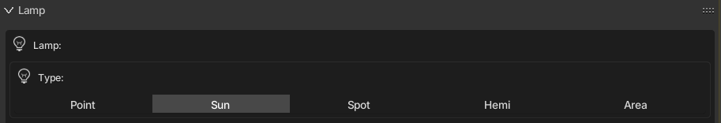

Classe base: [`KX_GameObject`](../kx_gameobject/)

:::tip[Veja também]
[`KX_WorldInfo`](../../types/kx_worldinfo/), [`KX_Scene`](../../types/kx_scene/)
:::




Uma luz do jogo: o objeto **Lamp** do editor (Add > Lamp). O tipo escolhido no painel Lamp é lido no Python com `type`:

- **Point**: `NORMAL`, ilumina em todas as direções a partir de um ponto, como uma lâmpada comum.
- **Sun**: `SUN`, luz paralela vinda de longe, para a luz do dia.
- **Spot**: `SPOT`, um cone de luz, como uma lanterna.
- **Hemi**: `HEMI`, luz suave vinda de uma meia esfera, sem sombras.
- **Area**: não tem tipo próprio no jogo e é lida como `NORMAL`.

**Fake (GPU Particle)**, no mesmo menu Add > Lamp, não é uma luz: é uma malha com uma partícula brilhante, então não é um `KX_LightObject`.

```python

# Confere o tipo da lâmpada ou muda durante o jogo.
import Range

light = Range.logic.getCurrentController().owner

if light.type == light.NORMAL:
    print("Point lamp")
elif light.type == light.SUN:
    print("Sun lamp")
elif light.type == light.SPOT:
    print("Spot lamp")
elif light.type == light.HEMI:
    print("Hemi lamp")

light.type = light.SPOT  # transforma em uma lâmpada Spot
```

```python

# Liga uma luz vermelha de alerta.
import Range

co = Range.logic.getCurrentController()
light = co.owner

light.energy = 1.0
light.color = [1.0, 0.0, 0.0]
```

```python

# Pisca como uma tocha. Rode a cada frame (sensor Always com True Pulse).
import random
import Range

light = Range.logic.getCurrentController().owner
light.energy = random.uniform(0.8, 1.2)
```

```python

# Liga ou desliga a luz. Uma luz invisível não atualiza a sombra.
import Range

light = Range.logic.getCurrentController().owner
light.visible = not light.visible
```

```python

# Opção de qualidade da sombra. Tamanhos maiores ficam mais nítidos, mas usam mais memória de vídeo.
# Luzes Point mantêm o Size definido no editor.
import Range

light = Range.logic.getCurrentController().owner
light.shadowMapSize = 1024  # por exemplo 512, 1024, 2048 ou 4096
```

```python

# Para de redesenhar a sombra a cada frame quando a cena muda pouco.
import Range

light = Range.logic.getCurrentController().owner
light.staticShadow = True

# Depois, ao mover algo que projeta sombra, redesenha uma vez.
light.updateShadow()
```

```python

# Fecha o cone de uma luz Spot e suaviza a borda.
import Range

light = Range.logic.getCurrentController().owner
if light.type == light.SPOT:
    light.spotsize = 45.0  # ângulo do cone em graus
    light.spotblend = 0.3  # suavidade da borda, de 0 a 1
```

### SPOT

Uma luz spot. Veja o atributo `type`

### SUN

Uma luz pontual sem atenuação. Veja o atributo `type`

### NORMAL

Uma luz pontual. Veja o atributo `type`

### HEMI

Uma luz hemi. Veja o atributo `type`

### type

O tipo da luz: SPOT, SUN ou NORMAL

### energy

O brilho desta luz.

**Tipo:** float

### shadowClipStart

O início do corte do shadow map; objetos mais perto que isso não geram sombra.

**Tipo:** float (read only)

### shadowClipEnd

O fim do corte do shadow map; objetos além disso não geram sombra.

**Tipo:** float (read only)

### shadowFrustumSize

Tamanho do frustum usado para criar o shadow map.

**Tipo:** float (read only)

### shadowBindId

O número/id de bind da textura de sombra no OpenGL.

**Tipo:** int (read only)

### shadowMapType

O tipo de shadow map (0 -> Simples; 1 -> Variance)

**Tipo:** int (read only)

### shadowBias

O bias de amostragem do buffer de sombra.

**Tipo:** float (read only)

### shadowBleedBias

O bias para reduzir o vazamento de luz nos shadow maps do tipo variance.

**Tipo:** float (read only)

### useShadow

Devolve True se a luz tem a opção Shadow ligada; caso contrário, False.

**Tipo:** boolean (read only)

### shadowColor

A cor das sombras desta luz. Preto = (0.0, 0.0, 0.0), branco = (1.0, 1.0, 1.0).

**Tipo:** `mathutils.Color` (read only)

### shadowMatrix

Matriz que converte um vetor do espaço da câmera para o espaço de profundidade do buffer de sombra.

Calculada como: mat4_perspective_to_depth * mat4_lamp_to_perspective * mat4_world_to_lamp * mat4_cam_to_world.

mat4_perspective_to_depth é uma matriz fixa, definida assim:

0.5 0.0 0.0 0.5 0.0 0.5 0.0 0.5 0.0 0.0 0.5 0.5 0.0 0.0 0.0 1.0

Observação:

Existe uma matriz dessas para cada lâmpada que projeta sombra na cena.

**Tipo:** Matrix4x4 (read only)

### distance

A distância máxima que esta luz ilumina (só luzes SPOT e NORMAL).

**Tipo:** float

### color

A cor desta luz. Preto = [0.0, 0.0, 0.0], branco = [1.0, 1.0, 1.0].

**Tipo:** list [r, g, b]

### lin_attenuation

A parte linear da atenuação desta luz (só luzes SPOT e NORMAL).

**Tipo:** float

### quad_attenuation

A parte quadrática da atenuação desta luz (só luzes SPOT e NORMAL).

**Tipo:** float

### spotsize

O ângulo do cone da luz spot, em graus (só luzes SPOT).

**Tipo:** float in [0 - 180].

### spotblend

A distribuição da intensidade da luz spot (só luzes SPOT).

**Tipo:** float in [0 - 1]

:::note
Valores mais altos deixam a luz mais concentrada.
:::

### shadowMapSize

Resolução do mapa de sombras em pixels (o Size da lâmpada). Ao definir este valor, o buffer de sombras é redimensionado em tempo real sem recompilar shaders, permitindo uma opção de qualidade de sombras (por exemplo, 512 / 1024 / 2048). Mapas de sombra em cascata mantêm sua proporção em relação a ele. Retorna 0 quando a lâmpada não possui buffer de sombras. Lâmpadas Point mantêm seu próprio tamanho.

**Tipo:** integer from 64 to 16384 (clamped to the graphics card maximum).

### staticShadow

Liga as sombras estáticas. Por padrão (staticShadow=False), a sombra da lâmpada é recalculada a cada frame. Quando isso não for preciso, defina staticShadow=True e chame `updateShadow` para pedir uma atualização da sombra.

**Tipo:** boolean.

### updateShadow()

Pede para a sombra ser atualizada no próximo frame, se a lâmpada usa sombra estática. Veja `staticShadow`.

## Sem documentação da Range

Estes itens existem na engine mas não estavam na documentação da Range. Os marcados **novo na Anastacio** foram adicionados pela Anastacio Engine.

### autoShadowUpdate

<span class="ae-badge novo">novo na Anastacio</span> <small>atributo</small>

Quando `False`, a sombra desta luz para de ser recalculada a cada frame (economiza GPU em cenas paradas).

