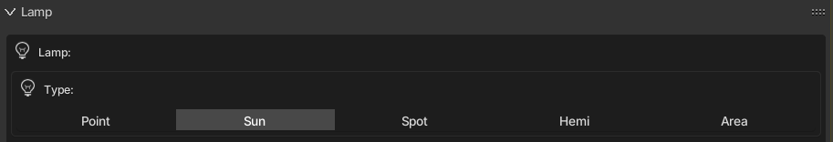

Base class: [`KX_GameObject`](../kx_gameobject/)

:::tip[See also]
[`KX_WorldInfo`](../../types/kx_worldinfo/), [`KX_Scene`](../../types/kx_scene/)
:::




A light in the game: the **Lamp** object of the editor (Add > Lamp). The type chosen in the Lamp panel is read in Python with `type`:

- **Point**: `NORMAL`, shines in all directions from one point, like a light bulb.
- **Sun**: `SUN`, parallel light from far away, for daylight.
- **Spot**: `SPOT`, a cone of light, like a flashlight.
- **Hemi**: `HEMI`, soft light from a half sphere, without shadows.
- **Area**: has no type of its own in the game and reads as `NORMAL`.

**Fake (GPU Particle)**, in the same Add > Lamp menu, is not a light: it is a mesh with one glowing particle, so it is not a `KX_LightObject`.

```python

# Check the type of the lamp, or change it during the game.
import Range

light = Range.logic.getCurrentController().owner

if light.type == light.NORMAL:
    print("Point lamp")
elif light.type == light.SUN:
    print("Sun lamp")
elif light.type == light.SPOT:
    print("Spot lamp")
elif light.type == light.HEMI:
    print("Hemi lamp")

light.type = light.SPOT  # turn it into a Spot lamp
```

```python

# Turn on a red alert light.
import Range

co = Range.logic.getCurrentController()
light = co.owner

light.energy = 1.0
light.color = [1.0, 0.0, 0.0]
```

```python

# Flicker like a torch. Run it every frame (Always sensor with True Pulse).
import random
import Range

light = Range.logic.getCurrentController().owner
light.energy = random.uniform(0.8, 1.2)
```

```python

# Turn the light on or off. An invisible light does not update its shadow.
import Range

light = Range.logic.getCurrentController().owner
light.visible = not light.visible
```

```python

# Shadow quality option. Bigger sizes look sharper but use more video memory.
# Point lamps keep the Size set in the editor.
import Range

light = Range.logic.getCurrentController().owner
light.shadowMapSize = 1024  # for example 512, 1024, 2048 or 4096
```

```python

# Stop redrawing the shadow every frame when the scene rarely changes.
import Range

light = Range.logic.getCurrentController().owner
light.staticShadow = True

# Later, after moving something that casts a shadow, redraw it once.
light.updateShadow()
```

```python

# Narrow the cone of a spot light and soften its edge.
import Range

light = Range.logic.getCurrentController().owner
if light.type == light.SPOT:
    light.spotsize = 45.0  # cone angle in degrees
    light.spotblend = 0.3  # edge softness, from 0 to 1
```

### SPOT

A spot light source. See attribute `type`

### SUN

A point light source with no attenuation. See attribute `type`

### NORMAL

A point light source. See attribute `type`

### HEMI

A hemi light source. See attribute `type`

### type

The type of light - must be SPOT, SUN or NORMAL

### energy

The brightness of this light.

**Type:** float

### shadowClipStart

The shadowmap clip start, below which objects will not generate shadows.

**Type:** float (read only)

### shadowClipEnd

The shadowmap clip end, beyond which objects will not generate shadows.

**Type:** float (read only)

### shadowFrustumSize

Size of the frustum used for creating the shadowmap.

**Type:** float (read only)

### shadowBindId

The OpenGL shadow texture bind number/id.

**Type:** int (read only)

### shadowMapType

The shadow shadow map type (0 -> Simple; 1 -> Variance)

**Type:** int (read only)

### shadowBias

The shadow buffer sampling bias.

**Type:** float (read only)

### shadowBleedBias

The bias for reducing light-bleed on variance shadow maps.

**Type:** float (read only)

### useShadow

Returns True if the light has Shadow option activated, else returns False.

**Type:** boolean (read only)

### shadowColor

The color of this light shadows. Black = (0.0, 0.0, 0.0), White = (1.0, 1.0, 1.0).

**Type:** `mathutils.Color` (read only)

### shadowMatrix

Matrix that converts a vector in camera space to shadow buffer depth space.

Computed as:
mat4_perspective_to_depth * mat4_lamp_to_perspective * mat4_world_to_lamp * mat4_cam_to_world.

mat4_perspective_to_depth is a fixed matrix defined as follow:

0.5 0.0 0.0 0.5
0.0 0.5 0.0 0.5
0.0 0.0 0.5 0.5
0.0 0.0 0.0 1.0

.. note:

There is one matrix of that type per lamp casting shadow in the scene.

**Type:** Matrix4x4 (read only)

### distance

The maximum distance this light can illuminate. (SPOT and NORMAL lights only).

**Type:** float

### color

The color of this light. Black = [0.0, 0.0, 0.0], White = [1.0, 1.0, 1.0].

**Type:** list [r, g, b]

### lin_attenuation

The linear component of this light's attenuation. (SPOT and NORMAL lights only).

**Type:** float

### quad_attenuation

The quadratic component of this light's attenuation (SPOT and NORMAL lights only).

**Type:** float

### spotsize

The cone angle of the spot light, in degrees (SPOT lights only).

**Type:** float in [0 - 180].

### spotblend

Specifies the intensity distribution of the spot light (SPOT lights only).

**Type:** float in [0 - 1]

:::note
Higher values result in a more focused light source.
:::

### shadowMapSize

Shadow map resolution in pixels (the lamp's Size). Setting it resizes the shadow buffer on
the fly without recompiling shaders, for a shadow quality option (e.g. 512 / 1024 / 2048).
Cascaded shadow maps keep their ratio to it. Reads 0 when the lamp has no shadow buffer.
Point lamps keep their own size.

**Type:** integer from 64 to 16384 (clamped to the graphics card maximum).

### staticShadow

Enables static shadows. By default (staticShadow=False) the shadow cast by the lamp is recalculated every frame. When this is not needed, set staticShadow=True. In that case, call :py`updateShadow` to request a shadow update.

**Type:** boolean.

### updateShadow()

Set the shadow to be updated next frame if the lamp uses a static shadow, see `staticShadow`.

## Not in the Range documentation

These items exist in the engine but were not in the Range documentation. The ones marked **new in Anastacio** were added by Anastacio Engine.

### autoShadowUpdate

<span class="ae-badge novo">new in Anastacio</span> <small>attribute</small>

When `False`, this light shadow stops being recomputed every frame (saves GPU in static scenes).

