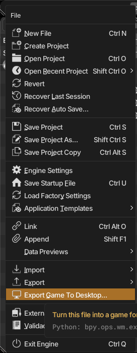
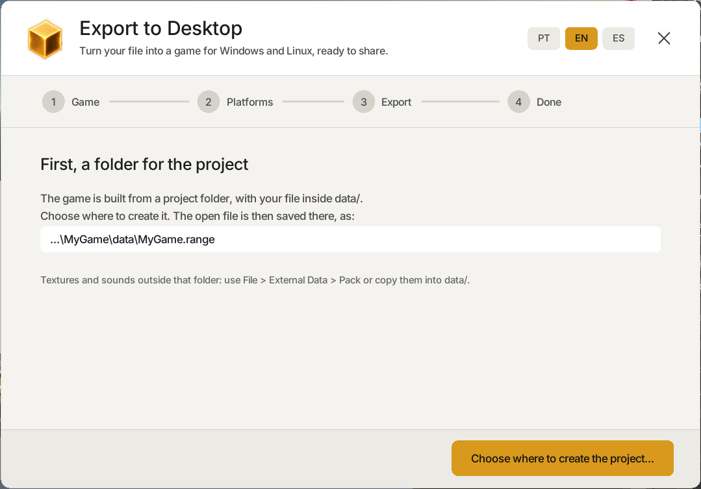
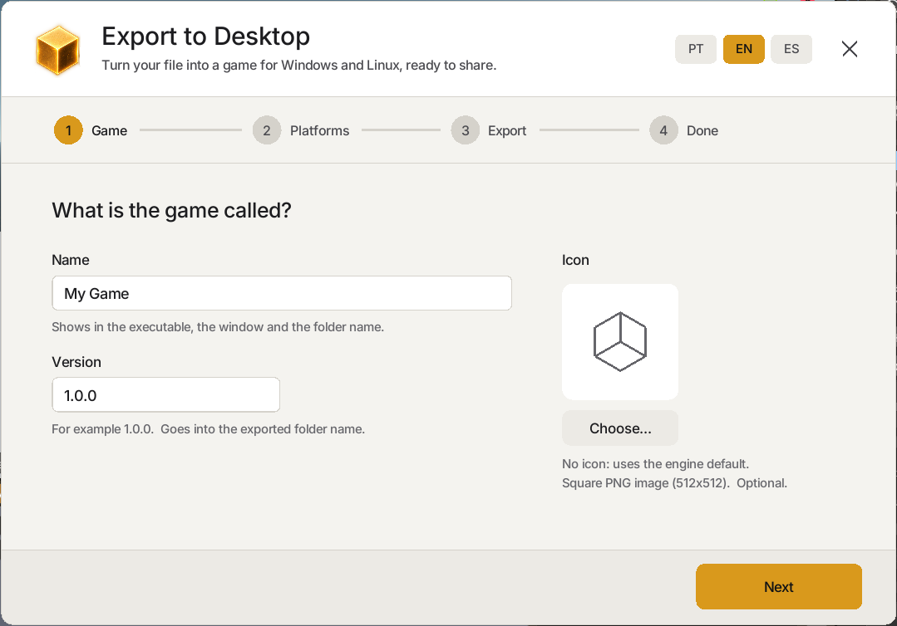
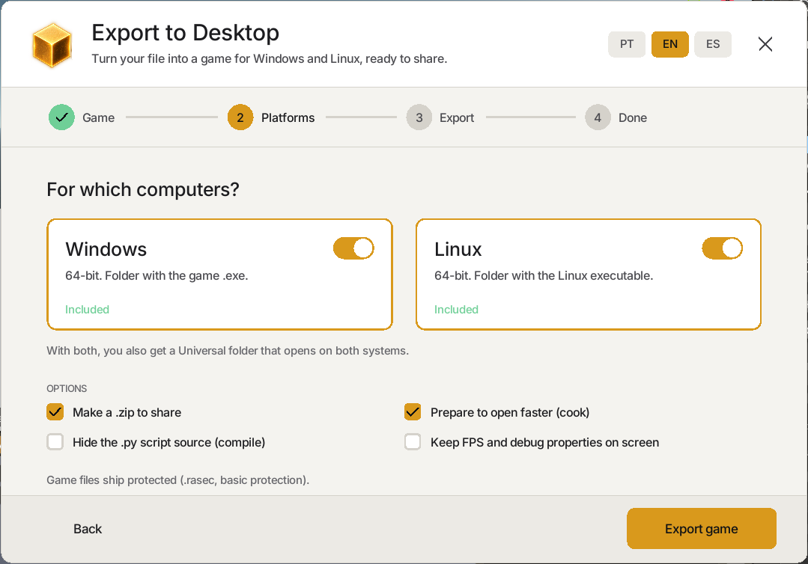
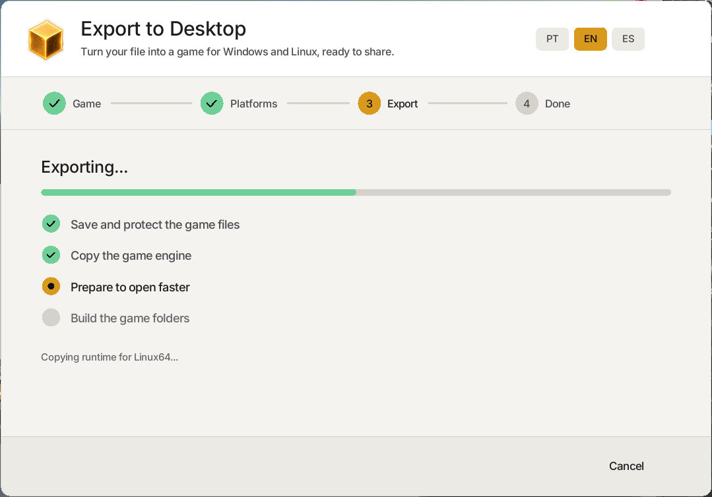
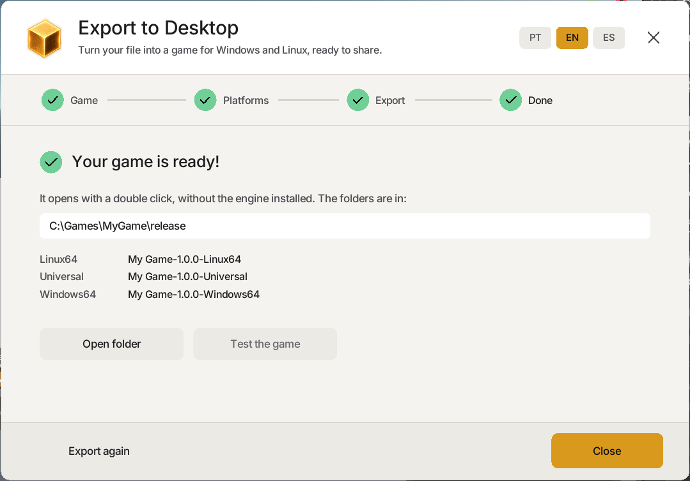

The **Export to Desktop** window turns your `.range` into a game that opens with a double click, without the engine installed. A single export builds the **Windows 64-bit** and **Linux 64-bit** versions, and with both on you also get a **Universal** folder that opens on both systems.

:::note[Changed since RangeArmor]
Exporting now ships inside the engine. You no longer download RangeArmor, create the `rangearmor/` folder or save the `.rasec` by hand: the window does all of it.
:::

## Opening the window

- **File > Export Game To Desktop...**, or
- **Properties > Export Game > Export to Desktop**, button **Export to Desktop...**

The window walks through **Game → Platforms → Export → Done**, shown at the top. The **PT / EN / ES** buttons switch the language; **Esc** or the **X** closes it.

## First: the project folder

The game is built from a project folder, with your file inside `data/`. If the open file is not in such a folder yet, the window starts with this step:

Click **Choose where to create the project...** and pick a folder. The engine creates `MyGame/data/` and saves the open file inside it, as `MyGame/data/MyGame.range`. From then on, edit that file.

:::caution
Textures, sounds and scripts outside the project folder are not included. Use **File > External Data > Pack** or copy them into `data/`, with **relative paths** (`//textures/...`).
:::

## 1. Game

| Field | What it does |
|---|---|
| **Name** | Shows in the executable, the game window and the folder name. Required. |
| **Version** | For example `1.0.0`. Goes into the exported folder name. |
| **Icon** | Square PNG image (512x512), optional. Without one, the engine icon is used. |

## 2. Platforms

Click the **Windows** and **Linux** cards to turn each one on or off. A grey card saying *"Engine for this platform not found"* means your installation lacks the runtime for that system.

| Option | What it does |
|---|---|
| **Make a .zip to share** | Besides the folder, builds a `.zip` ready to send. |
| **Prepare to open faster (cook)** | Builds the "cooked" cache (physics and shaders ready). Keep it on. |
| **Hide the .py script source (compile)** | Ships compiled scripts instead of source code. |
| **Keep FPS and debug properties on screen** | Keeps debug text in the exported game. Turn it off for players. |

Game files ship protected (`.rasec`, basic protection). Click **Export game**.

## 3. Export

The window shows each stage: save and protect the game files, copy the game engine, prepare to open faster and build the game folders. The editor keeps responding and you can **Cancel**.

If something fails, the title becomes *"The export stopped"* with the error. **Copy log** copies the full log and **Export game** tries again.

## 4. Done

The folders are in `MyGame/release/`, one per platform plus **Universal**. **Open folder** shows the result and **Test the game** runs the version for this computer.

## Exporting again

After the first time, **Export Now (last settings)** in **Properties > Export Game > Export to Desktop** exports right away with your last choices, without opening the window.

## Test and ship

1. **Extract the zip into any folder outside the project** (or copy the exported folder elsewhere).
2. Open the executable and play from start to finish.
3. If it works, that zip is what you send to players (itch.io, Steam, Google Drive...).

Testing outside the project matters: inside it the game may find files that did not make it into the package.

## File protection

The exported game uses a **protected** copy of the `.range` (`.rasec`), which does not open in the editor. Always keep the original `.range`: only it can be edited.
