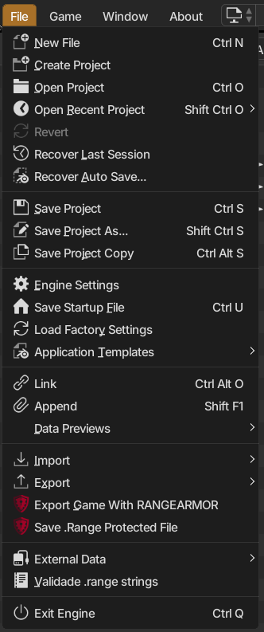
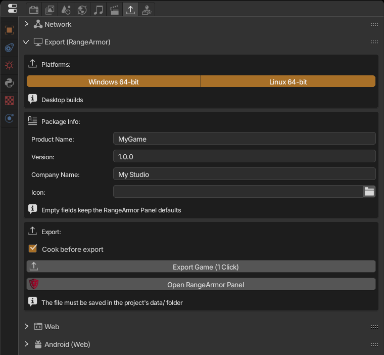
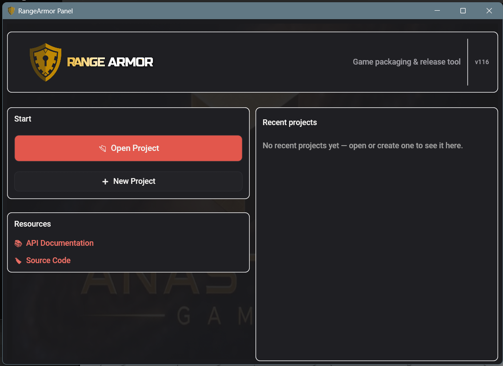
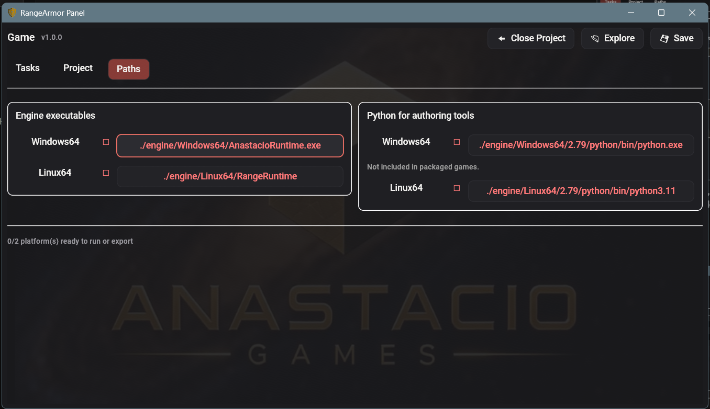
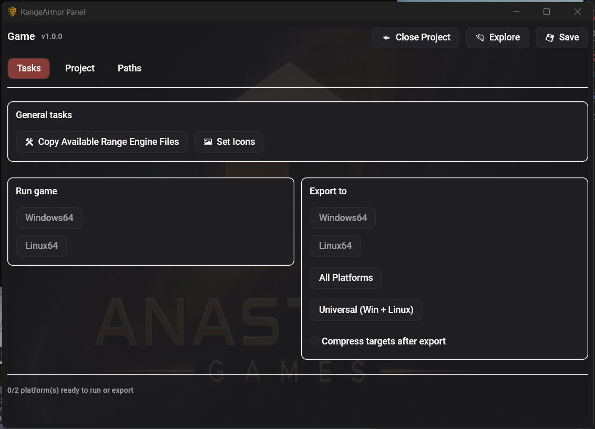

**RangeArmor** is the tool that packages the game for PC. It bundles the engine runtime, your protected `.range` and a launcher into an executable the player opens with a double click. A single export can produce both the **Windows 64-bit** and the **Linux 64-bit** builds.

:::note
The RangeArmor panel runs on Windows. It exports to Windows and Linux.
:::

## 1. Install RangeArmor

RangeArmor is downloaded separately from the engine, on the same release page (`RangeArmor-<version>-windows-x64.zip`).

1. Extract the zip.
2. Rename the extracted folder to **`rangearmor`** and put it **inside the engine folder**, next to `AnastacioEngine.exe`:

```
AnastacioEngine-0.5.0-windows-x64/
├── AnastacioEngine.exe
├── AnastacioRuntime.exe
└── rangearmor/
    ├── RangeArmor Panel.exe
    └── release/
```

The engine looks for exactly `rangearmor/RangeArmor Panel.exe` at that spot. If the folder has another name, the export buttons can't find the tool.

## 2. Create the project

RangeArmor works with a project folder in a fixed layout. The easiest way to create one is from the engine:



The **File** menu has **Create Project**, **Export Game With RANGEARMOR** and **Save .Range Protected File**.

1. **File > Create Project**.
2. Choose where to create it and give it a name (no `< > : " / \ | ? *`).
3. The engine creates this structure and opens the new `.range`:

```
MyGame/
├── data/            ← the game's .range goes HERE
│   ├── MyGame.range
│   ├── scripts/  textures/  models/  audio/  fonts/  scenes/  libloads/
├── engine/          ← runtime copied on export
├── launcher/        ← config.json and launcher
├── icons/
└── release/         ← export output
```

:::caution[Most important rule]
The main `.range` must be **inside the project's `data/` folder**. If it's somewhere else, the export says: *"Current file is not inside a RangeArmor project"*.
:::

Already have a finished game? Create the project, then copy your `.range` and its files (textures, sounds, scripts) into `data/`, keeping the same subfolders so relative paths keep working.



## 3. Configure the Export (RangeArmor) panel

In **Properties > Export Game > Export (RangeArmor)**:

| Field | What it does |
|---|---|
| **Windows 64-bit / Linux 64-bit** | Platforms to build. You can enable both. |
| **Product Name** | Game name, used for the executable and the package. |
| **Version** | Package version, for example `1.0.0`. |
| **Company Name** | Your name or studio. |
| **Icon** | `.ico` file for the executable. Empty keeps the default icon. |
| **Cook before export** | Builds the "cooked" cache (physics and shaders ready) so the game opens faster. Leave it on. |

Empty fields keep RangeArmor's defaults.

## 4. Export

There are two buttons:

- **Export Game (1 Click)**: saves a protected copy, cooks the cache and builds everything straight into `MyGame/release/`. The folder opens when it's done. **This is the recommended path.**
- **Open RangeArmor Panel**: opens the full tool, with more options. The engine panel settings are passed to it.

The same panel also opens from **File > Export Game With RANGEARMOR**.

:::tip
If you see *"Could not find a Python interpreter for the export"*, open RangeArmor Panel once, click **Get RanGE** and try 1 Click again.
:::

## Another way: using RangeArmor Panel on its own

You can also export without the engine buttons, by opening the external tool directly. It's useful to export an older project or change options the engine panel doesn't show.



RangeArmor Panel start screen: **Open Project**, **New Project** and the **Recent projects** list.

1. Open **`rangearmor/RangeArmor Panel.exe`** in the engine folder. It also opens from the **Open RangeArmor Panel** button or **File > Export Game With RANGEARMOR**.
2. On the start screen, click **New Project** to create a new project folder, or **Open Project** to open an existing one (for example, the one made with **File > Create Project**). Projects opened before show up under **Recent projects**.
3. In the engine, open your `.range` and save the protected copy with **File > Save .Range Protected File** inside the project's `data/` folder. It has the `.rasec` extension.
4. Back in the panel, on the **Project** tab:

| Field | What it does |
|---|---|
| **Game Name** | Game name. |
| **Version** | Game version. |
| **Main File** | The `.rasec` file from step 3. While it's still the example file, export is blocked. |
| **Data Source** | Folder with the game files (usually `data`). |
| **Compile Python scripts** | Ships compiled scripts instead of the source code. |

5. On the **Paths** tab, check **Engine executables** (the runtime for each platform) and **Python for authoring tools**. If they're empty, use **Copy Available Range Engine Files** on the **Tasks** tab, which copies the engine runtime into the project's `engine/` folder.
   

   Paths in **red** with an empty box are files that don't exist yet in the project's `engine/` folder. After **Copy Available Range Engine Files**, they get checked (✓) and the platform counts as ready at the bottom.

6. Click **Save** to store the settings.
7. On the **Tasks** tab:
   - **Run game**: runs the game the way the player will see it, to test first.
   - **Set Icons**: picks the `.ico` icons for the launcher and the executable.
   - **Export to**: exports one platform or **All Platforms**. **Compress targets after export** creates the zip.
   

   Gray platform buttons and the *0/2 platform(s) ready* note at the bottom mean the runtime is missing. Click **Copy Available Range Engine Files** (step 5) and check **Main File** and **Data Source**; the buttons light up once the platform is ready.

8. The output goes to the project's `release/` folder. **Explore** opens the folder and **Copy Log** copies the log if something goes wrong.

:::note
The engine's **Export Game (1 Click)** button does steps 3 to 7 by itself, and also cooks the cache. Use the external panel when you need manual control.
:::

## 5. Test and ship

1. Open `release/` and **extract the generated zip into any folder outside the project**.
2. Run the game executable and play it from start to finish.
3. If it works, that zip is what you send to players (itch.io, Steam, Google Drive...).

Testing outside the project matters: inside it, the game may find files that never made it into the package.

## File protection

The exported game uses a **protected** copy of the `.range` (`.rasec` extension), which doesn't open in the editor. You can also create this copy manually with **File > Save .Range Protected File**. Always keep the original `.range`: it's the only one you can edit.

## Common problems

| Message | Fix |
|---|---|
| *Save the .blend file inside the project's data/ folder first* | Save the file inside `data/`. |
| *Current file is not inside a RangeArmor project* | The `.range` is not in `<project>/data/`. Use **File > Create Project**. |
| *build_release.py not found next to RangeArmor Panel* | The `rangearmor/` folder is missing or misnamed. See step 1. |
| *Export finished with errors* | Open the console (**Window > Toggle System Console**) to see the full error. |
