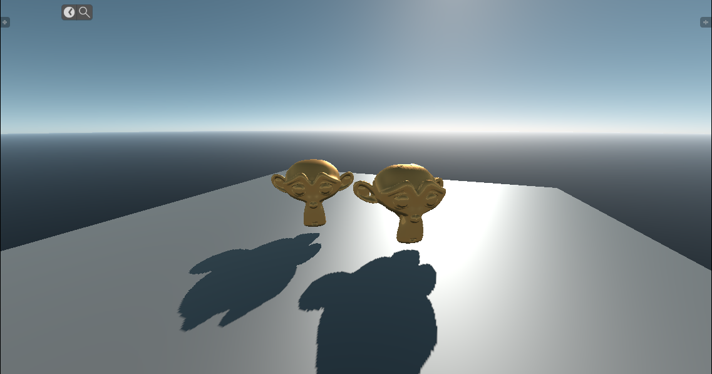
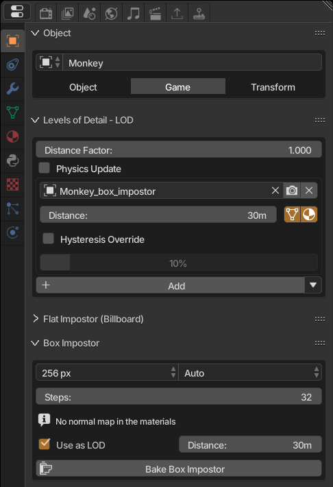
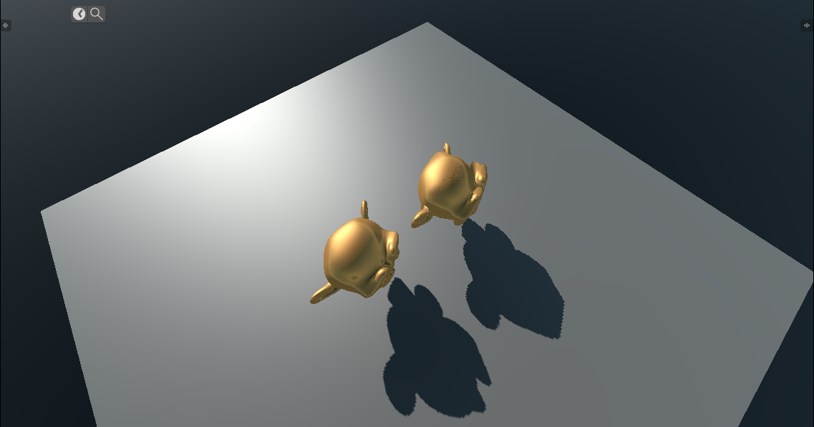

The **Box Impostor** photographs the object from 6 sides and stores those views on a card that always faces the camera. In game, the card draws the object with **real volume**: you can look from the side, from above or walk around it, and the scene light still hits it. It is a cheap way to fill a scene with objects that stay far from the camera.

On the left, the original mesh (7,872 faces). On the right, the impostor card: a single quad.

## When to use it

| Situation | Best choice |
|---|---|
| Trees and plants seen only from the side, far away | **Flat Impostor (Billboard)**: a plane that turns around Z, the cheapest. |
| Houses, crates, rocks, parked cars, statues | **Box Impostor**: keeps the volume from any angle, even from above. |
| Object close to the camera | The regular mesh (or a LOD level with fewer faces). |

The Box Impostor costs a bit more GPU than the Flat Impostor, but far less than the full mesh. In a test scene with 1,600 subdivided monkeys, draw time went from 1.73 ms down to 0.27 ms with the cards.

## Step by step

1. Select the object (it must be a mesh).
2. In **Properties > Object**, click **Game** on the top strip.
3. Open the **Box Impostor** panel (below **Levels of Detail - LOD**).

4. Set the options and click **Bake Box Impostor**.

| Option | What it does |
|---|---|
| **Resolution** (64 to 512 px) | Size of each of the 6 views. 256 is a good default; go higher only for objects that are big on screen. |
| **Mode** | **Auto** picks for you. **Box** does a single read and suits objects that fill their box (houses, crates, walls); it is the fastest. **Volume** works for any shape (characters, trees, the monkey above). |
| **Steps** | Search steps in Volume mode. Fewer is faster, but thin parts may vanish. |
| **Include Normal Map** | Bakes the material normal maps into the impostor. Doubles the bake time. Only shown when the material has a normal map. |
| **Use as LOD** + **Distance** | Adds the card as a LOD level of the object: beyond that camera distance the game swaps the mesh for the card. |

After the bake, the **Levels of Detail - LOD** panel lists the card `<object>_box_impostor` as a new level at the chosen distance. The card lives on **layer 20**, out of view, and the baked images are `<object>_imp_color` and `<object>_imp_data`.

## Testing

Press **P** and move the camera away. Past the LOD distance the mesh becomes the card, and the swap is hard to notice. To compare up close, as in the screenshots, duplicate the card (`Shift+D`), move the copy to layer 1 and place it next to the original.

Seen from above, the impostor keeps the shape of the object, which a regular billboard cannot do.

## Tips

- **Changed the object or its material?** Click **Bake Box Impostor** again. The card and images are rebuilt in place.
- **Many copies:** the card works with GPU Instancing, so hundreds of copies are cheap.
- **Objects parented to bones** (a hat on a character's head, for example) work too.
- **Shadow:** the card's shadow is an approximation. If it stands out, raise the LOD distance.
- From Python, you can cap an object's highest LOD level with [`KX_GameObject.lodLevelMax`](../../api/types/kx_gameobject/#lodlevelmax).
