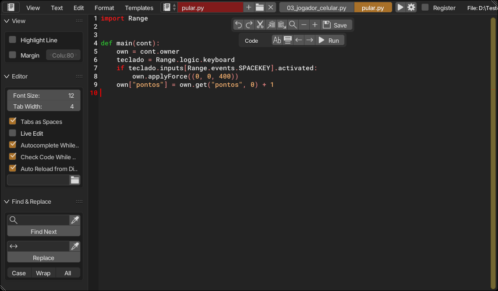
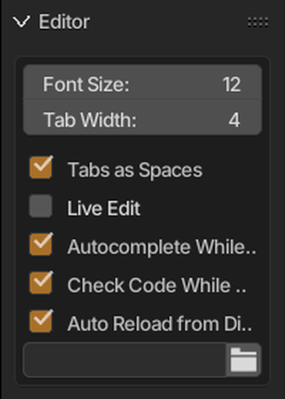

You can write your game scripts in **VS Code** (or another editor) and see the changes reach the engine without doing anything: the **Text Editor** opens the file in the external editor with one click, and reloads the script by itself when you save there.



## First: the script must be a file

The external editor only opens scripts saved on disk. If the text was created inside the engine (**Text > New**), save it first with **Text > Save As**, ideally in a `scripts/` folder next to the `.range`. Scripts opened with **Text > Open** are already linked to their file.

## Opening in the external editor

On the Text Editor bar, next to the run script button (▶), click **Open in External Editor** (the gear):


- The file opens in **VS Code, right at the cursor line**.
- If you changed the text inside the engine, it saves first so VS Code sees the current version.
- Text not saved to a file yet? The engine warns you and opens **Save As**.

The script button of **Smart Components** (in the Component Manager) uses the same editor.

## Reloading on its own

Save in VS Code (`Ctrl+S`) and go back to the engine: the text is already up to date, with the cursor in the same place. The engine checks the files every half second.

The option is in the Text Editor sidebar (`Ctrl+T`), **Editor** panel:



- **Auto Reload from Disk** turns reloading on or off. It starts on.
- The field below it is the **external editor path** (the folder button opens the file browser).

:::caution[Edited in both places?]
If the text was changed **in the engine** and **on disk** at the same time, it does not reload by itself, so nothing you wrote is lost. The **Resolve Conflict** bar appears: pick which version stays.
:::

## Choosing another editor

With the field empty, the engine looks for VS Code (`code`, `code-insiders` or `codium` on the PATH, or the default install on Windows). If it finds none, it uses the system default program for `.py`.

To use another editor, put its path in the field. If the editor needs arguments, use `{file}` and `{line}`:

```
C:\Program Files\Notepad++\notepad++.exe -n{line} {file}
```

The path applies to every `.range` file, because it is kept in the user config folder.

## From Python

Reloading uses `Text.reload()`, which you can also call in your editor scripts:

```python
import bpy
bpy.data.texts["pular.py"].reload()  # reads the file again, keeping the cursor
```
