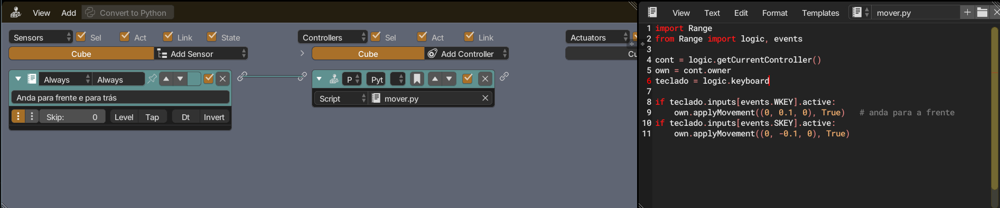
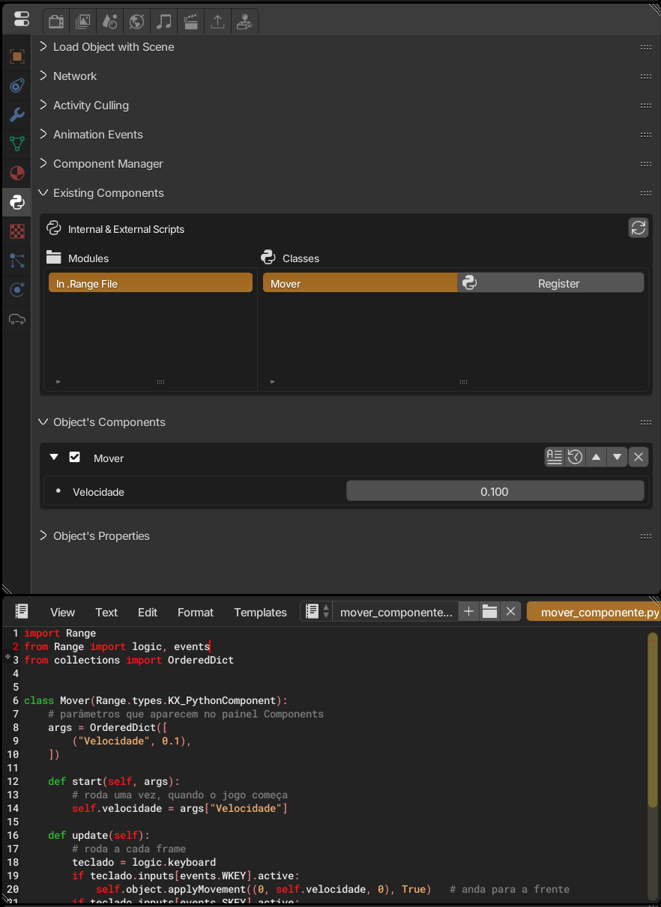

1. Select an object in the scene and add an **Always** sensor (with *True Level Triggering* on) connected to a **Python** controller.
2. Create a text called `mover.py` in the text editor and pick it in the controller.
3. Paste the code and press **P** to play.



```python
import Range
from Range import logic, events

cont = logic.getCurrentController()
own = cont.owner
teclado = logic.keyboard

if teclado.inputs[events.WKEY].active:
    own.applyMovement((0, 0.1, 0), True)   # anda para a frente
if teclado.inputs[events.SKEY].active:
    own.applyMovement((0, -0.1, 0), True)
```

The code uses Portuguese names, the same ones shown in the screenshots: `mover` = move, `teclado` = keyboard, `Velocidade` = speed.

- `logic.getCurrentController()` returns the controller running the script.
- `own` is the object that owns the controller, a [`KX_GameObject`](../../api/types/kx_gameobject/).
- `applyMovement(vector, local)` moves the object; `True` uses the object's own axes.

## The same with a component

A component does the same job without logic bricks. It is a Python class attached to the object, and you can change its parameters in the panel without touching the code.

1. Create a text called `mover_componente.py` in the text editor (the name must end in `.py`) and paste the code below.
2. Select the object and open the components tab (Python icon) in the properties. In **Existing Components**, choose **In .Range File** under *Modules*, then the **Mover** class under *Classes*, and click **Register**. If the class doesn't show up, click the refresh button in the panel corner.
3. The component shows up in **Object's Components**, with the **Velocidade** field. Adjust it if you want and press **P** to play.



```python
import Range
from Range import logic, events
from collections import OrderedDict


class Mover(Range.types.KX_PythonComponent):
    # parâmetros que aparecem no painel Components
    args = OrderedDict([
        ("Velocidade", 0.1),
    ])

    def start(self, args):
        # roda uma vez, quando o jogo começa
        self.velocidade = args["Velocidade"]

    def update(self):
        # roda a cada frame
        teclado = logic.keyboard
        if teclado.inputs[events.WKEY].active:
            self.object.applyMovement((0, self.velocidade, 0), True)   # anda para a frente
        if teclado.inputs[events.SKEY].active:
            self.object.applyMovement((0, -self.velocidade, 0), True)
```

- The class inherits from [`KX_PythonComponent`](../../api/types/kx_pythoncomponent/).
- `args` defines the panel parameters. The `OrderedDict` order is the order they show up in.
- `start(args)` receives the panel values; `update()` runs every frame, before the logic bricks.
- `self.object` is the object that owns the component, instead of the script's `cont.owner`.

**Script or component?** Use a script with logic bricks to connect sensors and actuators visually. Use a component when the logic is all Python and you want to reuse the same class on several objects, each with its own values.
