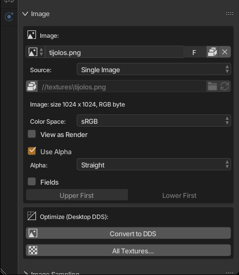
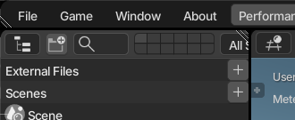
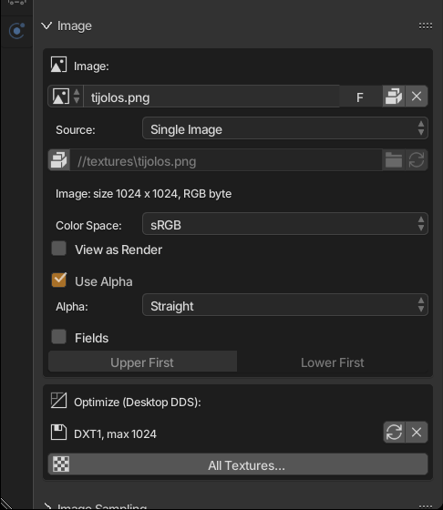

PNG or JPG textures take a lot of video memory. The **DDS** format stays compressed on the GPU itself, uses up to **8 times less memory** and ships with mipmaps ready, so the game loads faster. You can now convert **a single image**, right in its panel.

:::note
DDS is used only in the **game exported to PC** (Windows and Linux). The editor, the Web and Android keep using the original image, which you can keep editing.
:::

## Step by step

1. **Save the project** (`Ctrl+S`). The DDS copy is written next to it, so the button only works after saving.
2. Select the object and open **Properties > Texture**.
3. Pick the image texture in the list. At the bottom of the **Image** panel is the **Optimize (Desktop DDS)** box:

4. Click **Convert to DDS**. Two options show up:

| Option | What it does |
|---|---|
| **Maximum size** | Longest side of the texture in game: **Original**, 4096, 2048, 1024 or 512. Going lower saves even more memory. |
| **Quality** | **High** compresses more carefully (default). **Fast** converts quicker. |

5. Click **OK** and **save the project** again to keep the choice.

Done: the box now shows the format and size in use.

## Buttons after converting

- **Reload** (arrows) converts again, for example after changing the maximum size or the image.
- **X** undoes it: the game goes back to the original image.
- **All Textures...** converts every texture in the project at once.

## The format is picked for you

| Image | Format |
|---|---|
| Color without transparency | BC1 (shown as DXT1) |
| Color with transparency | BC3 (DXT5) |
| Normal map | BC5 |

The files go in the `textures_dds/` folder next to the `.range`. If you edit the original image later, the engine notices at export time and asks you to convert again.

## When to convert

- Large textures (1024 and up) and many textures in the same scene.
- A game that stutters while loading or uses a lot of video memory (see the **Performance** menu).

There is no need to convert small HUD icons or images used only in the editor.
