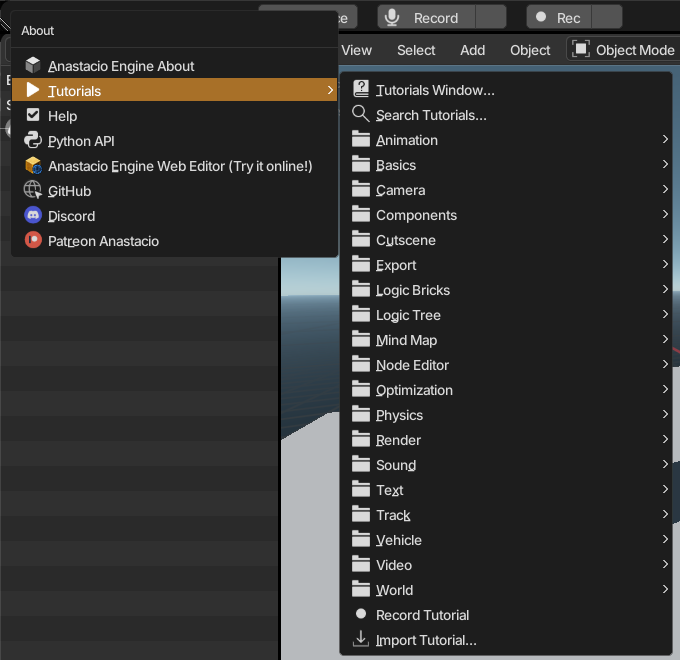
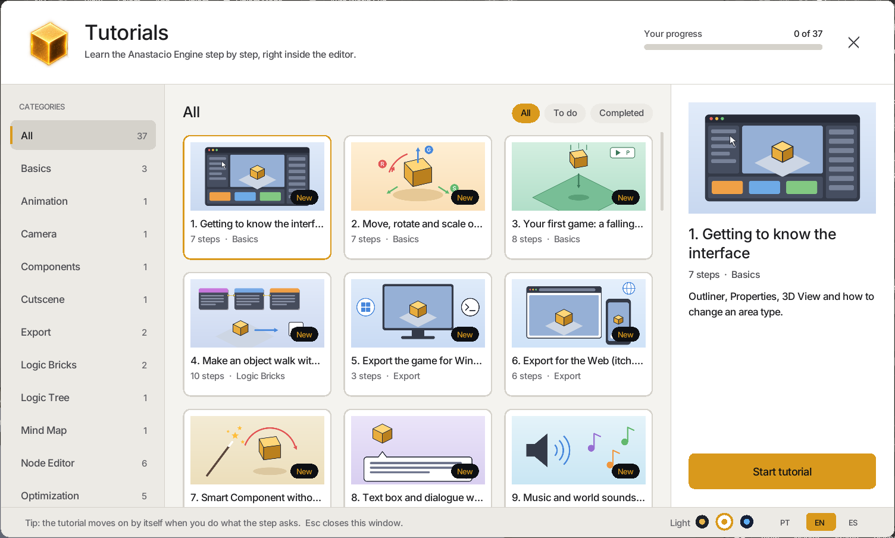
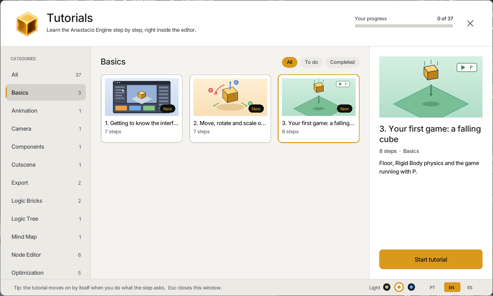
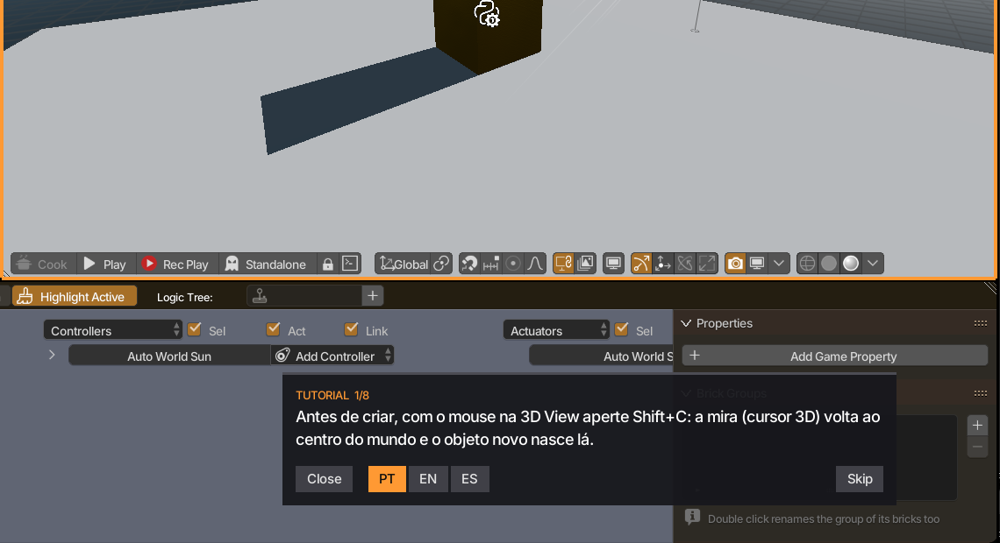
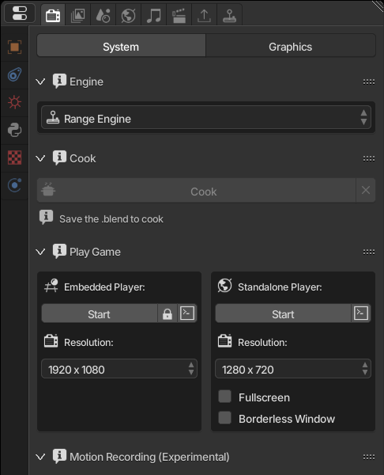

The engine ships **interactive tutorials** in Portuguese, English and Spanish. A card shows what to do, and the tutorial **advances on its own** when you do the step in the real editor. For quick questions, **Help** puts an "i" on panels with an explanation of each one.

## Opening the tutorials

Everything lives in the **About** menu on the top bar:

- **Tutorials > Tutorials Window...** opens the window with every tutorial.
- **Tutorials > Search Tutorials...** finds one by name.
- The folders (**Basics**, **Animation**, **Camera**...) go straight to each tutorial.
- **Help** turns the "i" on panels on or off.

## The tutorials window

- **Categories** are on the left, with how many tutorials each one has.
- The **All**, **To do** and **Completed** filters split what you have already finished.
- **Your progress** shows how many tutorials you have done.
- The footer has the themes (**Light**, **Dark**, **Blue**) and the language (**PT / EN / ES**).

Click a card to see its details on the right:

**Start tutorial** starts from scratch. If you stopped halfway, **Continue from step N** appears, and finished tutorials show **Do it again**. **Esc** closes the window.

:::note
Many tutorials open a ready-made starting scene. If the open file has unsaved changes, the engine asks before switching.
:::

## Doing a tutorial

The card sits over the editor and shows the step number (**1/8**) and what to do. The part of the screen involved in the step is highlighted (in the screenshot, the 3D View with an orange border).

- Do what the step asks: it is ticked off on its own and the next one appears.
- **Skip** skips the step, and **Close** ends the tutorial (progress is saved).
- **PT / EN / ES** switches the language right there.

When you finish, the tutorial gets a green check in the menu and counts toward your progress.

## Help button

With **About > Help** on, panels that have an explanation get an **"i"** next to their name:

Click the "i" to open a small window with:

- what the panel does, in a few lines;
- when there is one, a button to **do the tutorial** on that topic;
- the **PT / EN / ES** buttons.

The small window goes away when the mouse leaves it. Help stays on the next times you open the engine, until you turn it off in the same menu.

## Topics

There are 37 tutorials, from the basics (interface, first game, moving objects) to advanced topics: Logic Bricks, Logic Tree, Cutscene, Compositing, Light Probe Volume, SSGI, microphone, Character, GLSL Nodes, exporting to PC and to the Web, and more. The full list is in the tutorials window.
