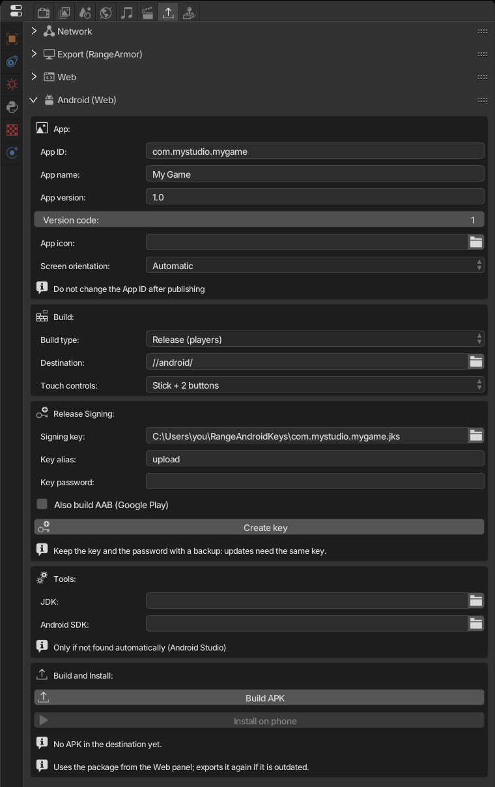

La exportación a Android genera un **APK**: una app que ejecuta dentro la versión [Web](../web/) del juego, sin conexión, sin necesidad de internet. Por eso configura y valida primero la Web: sus controles táctiles y avisos también aplican aquí.

## 1. Qué instalar primero

El motor **no** incluye las herramientas de Android. Instálalas una vez:

1. **[Android Studio](https://developer.android.com/studio)**. Trae el **JDK** (Java) y el **Android SDK**, las dos cosas que el motor necesita.
2. Abre Android Studio una vez y deja que termine de descargar el SDK.
3. En **Tools > SDK Manager > SDK Platforms**, instala **Android SDK Platform 37**.

El motor encuentra Android Studio por sí solo (también revisa `JAVA_HOME` y `ANDROID_HOME`). Si está en otro lugar, indica las carpetas en **Tools > JDK** y **Android SDK** en el panel.

## 2. Abrir el panel

**Properties > Export Game > Android (Web)**.



## 3. App

| Campo | Qué hace |
|---|---|
| **App ID** | Identidad única de la app, como `com.tunombre.tujuego` (letras, números y `_`, separados por puntos; cada parte empieza con una letra). |
| **App name** | Nombre que aparece bajo el icono. Vacío usa el nombre del archivo. |
| **App version** | Versión que ve el jugador, por ejemplo `1.0`. |
| **Version code** | Número entero. **Auméntalo con cada versión nueva** (1, 2, 3...), o el teléfono rechaza la actualización. |
| **App icon** | PNG cuadrado, idealmente de 512×512. Vacío usa el icono predeterminado de Android. |
| **Screen orientation** | **Automatic** (gira con el teléfono), **Landscape** o **Portrait**. |

:::caution
**Nunca cambies el App ID después de publicar.** Android lo trataría como otra app: los jugadores tendrían dos iconos y perderían su partida guardada.
:::

## 4. Build

- **Build type**:
  - **Debug (testing)**: para probar en **tu** teléfono. No necesita clave. Úsalo mientras desarrollas.
  - **Release (players)**: versión final, firmada con tu clave. Úsala para publicar.
- **Destination**: carpeta del APK, el informe y el log (predeterminado `//android/`).
- **Touch controls**: los mismos controles en pantalla del panel Web.

## 5. La clave de firma (.jks)

Solo se necesita para **Release**. Toda app Android debe estar firmada, y **cada actualización debe firmarse con la misma clave** que la primera versión.

**No necesitas conseguir este archivo en ningún lado: el motor lo crea por ti.**

1. Pon **Build type** en **Release (players)**. Aparece el cuadro **Release Signing**.
2. Completa:
   - **Key alias**: nombre de la clave dentro del archivo. Puedes dejar `upload`.
   - **Key password**: una contraseña de **al menos 6 caracteres**.
3. Haz clic en **Create key**.

El motor usa el `keytool` del JDK para generar la clave (RSA 4096, válida por unos 27 años) y completa el campo **Signing key**. Si dejaste ese campo vacío, el archivo va a:

```
C:\Users\<tú>\RangeAndroidKeys\<App ID>.jks
```

Para elegir otra ubicación, completa **Signing key** con la ruta del archivo **antes** de hacer clic en **Create key**. El motor nunca sobrescribe una clave existente.

:::danger[Respalda la clave y la contraseña]
Copia el `.jks` a una memoria USB o a la nube y anota la contraseña en un lugar seguro. **Si pierdes cualquiera de las dos, ya no podrás actualizar el juego**: tendrías que publicarlo como una app nueva, y los jugadores perderían su partida guardada. No guardes la clave dentro del proyecto ni en Git.
:::

¿Ya tienes un `.jks` de otro juego o de Android Studio? Puedes usarlo: apunta **Signing key** a él y completa su alias y contraseña.

La contraseña no se guarda en el `.range`. Después de volver a abrir el motor, escríbela de nuevo antes de generar.

## 6. Generar el APK

Haz clic en **Build APK**. El motor guarda el archivo y ejecuta Gradle en segundo plano (la primera vez tarda más porque descarga dependencias). El progreso aparece en el panel.

La salida va a **Destination**: el `.apk`, `android-report.json` y `gradle.log` (abre este si algo sale mal).

**Also build AAB (Google Play)**: genera también el `.aab`, el formato que **Google Play exige**. El APK se sigue generando para que puedas instalarlo en tu teléfono.

## 7. Instalar en tu teléfono

1. En el teléfono, activa las **Opciones de desarrollador** (en *Acerca del teléfono*, toca *Número de compilación* 7 veces) y, dentro de ellas, la **Depuración USB**.
2. Conecta el teléfono a la PC con un cable USB y acepta el aviso *"¿Permitir depuración USB?"* en el teléfono.
3. Haz clic en **Install on phone**. El juego se instala y se abre solo.

También puedes copiar el `.apk` al teléfono y abrirlo desde el administrador de archivos (Android pide permitir "orígenes desconocidos").

## 8. Publicar en Google Play

1. Genera en **Release** con **Also build AAB** activado.
2. En la [Google Play Console](https://play.google.com/console), crea la app y sube el `.aab`.
3. La primera vez, acepta **Play App Signing**: Google guarda la clave final y tu `.jks` pasa a ser la *upload key*. Conserva tu respaldo de todos modos.
4. En cada actualización: aumenta el **Version code**, genera de nuevo con la **misma clave** y sube el nuevo `.aab`.

## Problemas comunes

| Mensaje | Solución |
|---|---|
| *JDK and Android SDK not found* (o *JDK not found*) | Instala Android Studio o indica las carpetas en **Tools**. |
| *The Android SDK ... does not have platform 37* | Android Studio > SDK Manager > instala **Android SDK Platform 37**. |
| *No phone connected* | Cable USB conectado y **Depuración USB** activada. Prueba otro cable: algunos solo cargan. |
| *The phone did not authorize this computer* | Desbloquea el teléfono y acepta el aviso de depuración USB. |
| *The phone already has ... signed with another key* | El teléfono tiene una versión firmada con otra clave (por ejemplo, la de Debug). Desinstálala e instala de nuevo. |
| *The phone has a newer version* | Aumenta el **Version code**. |
| Error de contraseña o alias al generar | La contraseña o el alias no coinciden con el `.jks`. |
