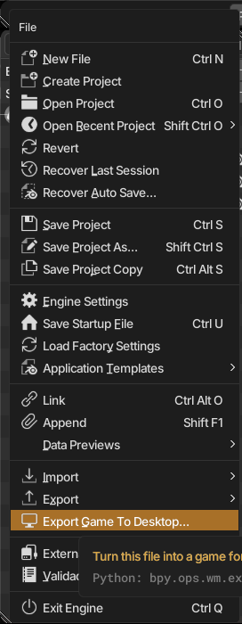
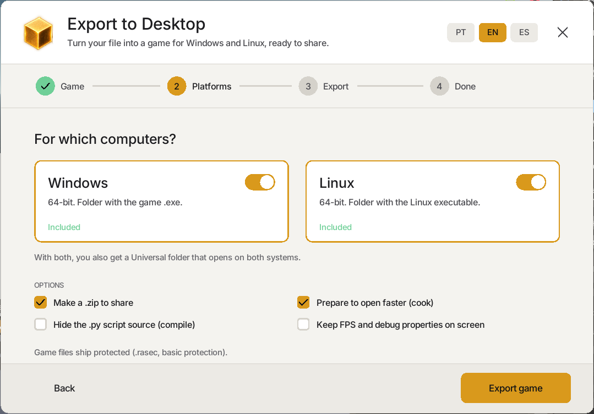
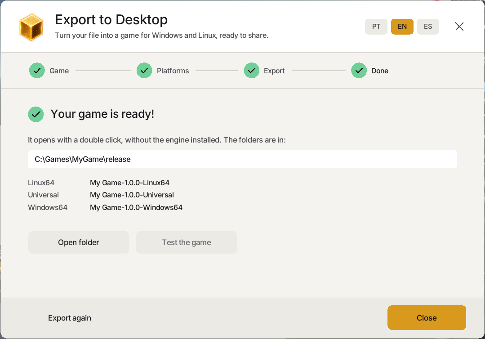

La ventana **Export to Desktop** convierte tu `.range` en un juego que abre con doble clic, sin la engine instalada. Una sola exportación genera la versión **Windows 64-bit** y la **Linux 64-bit**, y con las dos activadas sale también una carpeta **Universal** que abre en los dos sistemas.

:::note[Cambió desde RangeArmor]
La exportación ahora viene dentro de la engine. Ya no hace falta descargar RangeArmor, crear la carpeta `rangearmor/` ni guardar el `.rasec` a mano: la ventana lo hace todo.
:::

## Abrir la ventana

- **File > Export Game To Desktop...**, o
- **Propiedades > Export Game > Export to Desktop**, botón **Export to Desktop...**

La ventana sigue los pasos **Juego → Plataformas → Exportar → Listo**, mostrados arriba. Los botones **PT / EN / ES** cambian el idioma; **Esc** o la **X** la cierran.

## Antes: la carpeta del proyecto

El juego se arma desde una carpeta de proyecto, con tu archivo dentro de `data/`. Si el archivo abierto todavía no está en una carpeta así, la ventana empieza por este paso. Haz clic en **Elegir dónde crear el proyecto...**: la engine crea `MiJuego/data/` y guarda allí el archivo abierto.

:::caution
Texturas, sonidos y scripts fuera de la carpeta del proyecto no se incluyen. Usa **File > External Data > Pack** o cópialos a `data/`, con **rutas relativas** (`//textures/...`).
:::

## 1. Juego

| Campo | Qué hace |
|---|---|
| **Nombre** | Aparece en el ejecutable, la ventana del juego y la carpeta. Obligatorio. |
| **Versión** | Por ejemplo `1.0.0`. Va en el nombre de la carpeta exportada. |
| **Icono** | Imagen PNG cuadrada (512x512), opcional. Sin icono, usa el de la engine. |

## 2. Plataformas

Haz clic en las tarjetas **Windows** y **Linux** para activarlas o desactivarlas.

| Opción | Qué hace |
|---|---|
| **Generar .zip para compartir** | Además de la carpeta, genera un `.zip` listo para enviar. |
| **Preparar para abrir más rápido (cook)** | Genera la caché "cocinada" (física y shaders listos). Déjalo activado. |
| **Ocultar el código de los scripts .py (compilar)** | Entrega los scripts compilados en vez del código fuente. |
| **Mantener FPS y propiedades de depuración en pantalla** | Desactívalo para el jugador. |

Haz clic en **Exportar juego**.

## 3. Exportar y 4. Listo

La ventana muestra cada etapa y permite **Cancelar**. Si falla, **Copiar log** copia el registro completo. Al terminar, las carpetas quedan en `MiJuego/release/` (una por plataforma y la **Universal**); **Abrir carpeta** y **Probar el juego** están en la última pantalla.

Después, **Export Now (last settings)** en **Propiedades > Export Game > Export to Desktop** exporta de nuevo con las últimas opciones, sin abrir la ventana.

## Probar y distribuir

1. Extrae el zip en una carpeta **fuera del proyecto**.
2. Abre el ejecutable y juega de principio a fin.
3. Si funciona, ese zip es lo que envías al jugador.

El juego usa una copia **protegida** del `.range` (`.rasec`), que no abre en el editor. Guarda siempre el `.range` original.
