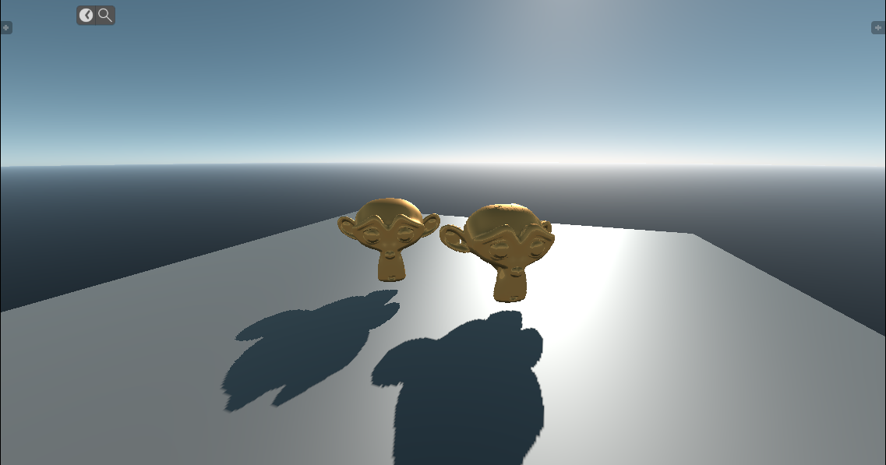
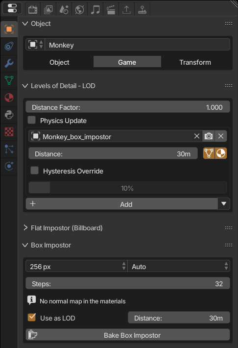
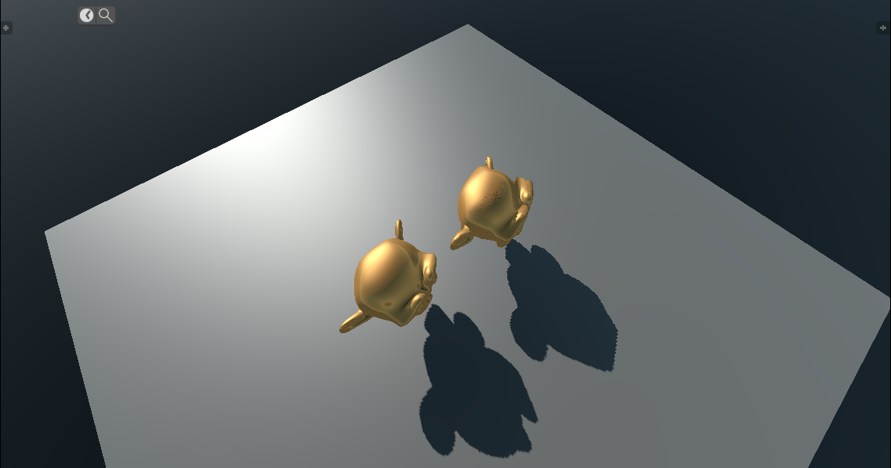

El **Box Impostor** fotografía el objeto desde 6 lados y guarda esas vistas en una tarjeta que siempre mira a la cámara. En el juego, la tarjeta dibuja el objeto con **volumen real**: se puede mirar de lado, desde arriba o rodearlo, y la luz de la escena sigue iluminándolo.

A la izquierda, la malla original (7.872 caras). A la derecha, la tarjeta del impostor: un solo cuadrado.

## Cuándo usarlo

| Situación | Mejor opción |
|---|---|
| Árboles y plantas vistos solo de lado, lejos | **Flat Impostor (Billboard)**, el más barato. |
| Casas, cajas, rocas, coches parados, estatuas | **Box Impostor**: mantiene el volumen desde cualquier ángulo. |
| Objeto cerca de la cámara | La malla normal (o un nivel de LOD con menos caras). |

En una escena de prueba con 1.600 monos subdivididos, el tiempo de dibujo bajó de 1,73 ms a 0,27 ms con las tarjetas.

## Paso a paso

1. Selecciona el objeto (debe ser una malla).
2. En **Propiedades > Object**, haz clic en **Game**.
3. Abre el panel **Box Impostor** (debajo de **Levels of Detail - LOD**).

4. Ajusta las opciones y haz clic en **Bake Box Impostor**.

| Opción | Qué hace |
|---|---|
| **Resolución** (64 a 512 px) | Tamaño de cada una de las 6 vistas. 256 es un buen valor. |
| **Modo** | **Auto** elige solo. **Box** sirve para objetos que llenan su caja (casas, cajas, paredes) y es el más rápido. **Volume** sirve para cualquier forma. |
| **Steps** | Pasos de búsqueda en modo Volume. Menos es más rápido, pero las partes finas pueden desaparecer. |
| **Include Normal Map** | Lleva los normal maps del material al impostor. Duplica el tiempo del bake. |
| **Use as LOD** + **Distance** | Añade la tarjeta como nivel de LOD: desde esa distancia, el juego cambia la malla por la tarjeta. |

Después del bake, el panel **Levels of Detail - LOD** muestra la tarjeta `<objeto>_box_impostor` como nuevo nivel. La tarjeta queda en la **capa 20**, fuera de la vista.

## Probar

Pulsa **P** y aleja la cámara: pasada la distancia del LOD, la malla se vuelve la tarjeta.

## Consejos

- ¿Cambiaste el objeto o el material? Haz clic en **Bake Box Impostor** de nuevo.
- La tarjeta funciona con GPU Instancing, así que cientos de copias cuestan poco.
- Funciona también en objetos emparentados a huesos.
- La sombra de la tarjeta es una aproximación; si se nota, aumenta la distancia del LOD.
- Desde Python, [`KX_GameObject.lodLevelMax`](../../api/types/kx_gameobject/#lodlevelmax) limita el nivel máximo de LOD.
