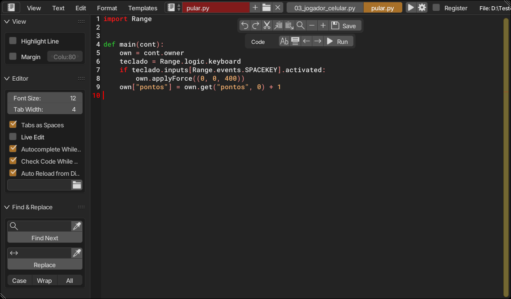
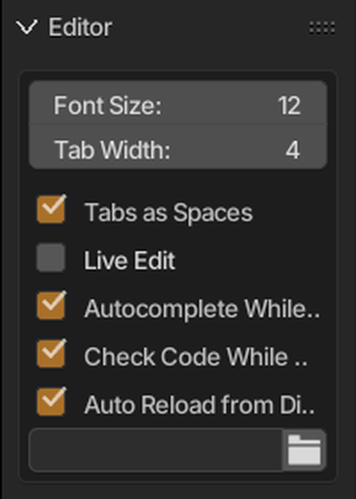

Puedes escribir los scripts del juego en **VS Code** (u otro editor) y ver los cambios llegar a la engine sin hacer nada: el **Text Editor** abre el archivo en el editor externo con un clic y recarga el script solo cuando guardas allí.



## Antes: el script debe ser un archivo

El editor externo solo abre scripts guardados en disco. Si el texto se creó dentro de la engine (**Text > New**), guárdalo primero con **Text > Save As**, mejor en una carpeta `scripts/` junto al `.range`.

## Abrir en el editor externo

En la barra del Text Editor, junto al botón de ejecutar (▶), haz clic en **Open in External Editor** (el engranaje):


- El archivo abre en **VS Code, en la línea del cursor**.
- Si cambiaste el texto en la engine, ella guarda antes de abrir.
- ¿El texto aún no está en un archivo? La engine avisa y abre **Save As**.

El botón de script de los **Smart Components** usa el mismo editor.

## Recargar solo

Guarda en VS Code (`Ctrl+S`) y vuelve a la engine: el texto ya está actualizado, con el cursor en el mismo lugar. La opción está en la barra lateral del Text Editor (`Ctrl+T`), panel **Editor**:



- **Auto Reload from Disk** activa o desactiva la recarga (viene activada).
- El campo de abajo es la **ruta del editor externo**.

:::caution[¿Editaste en los dos lugares?]
Si el texto cambió **en la engine** y **en el disco** a la vez, no se recarga solo. Aparece la barra **Resolve Conflict** para elegir qué versión queda.
:::

## Elegir otro editor

Con el campo vacío, la engine busca VS Code; si no lo encuentra, usa el programa predeterminado del sistema. Para otro editor, pon su ruta en el campo; si necesita argumentos, usa `{file}` y `{line}`:

```
C:\Program Files\Notepad++\notepad++.exe -n{line} {file}
```

## Desde Python

La recarga usa `Text.reload()`:

```python
import bpy
bpy.data.texts["pular.py"].reload()  # vuelve a leer el archivo, manteniendo el cursor
```
