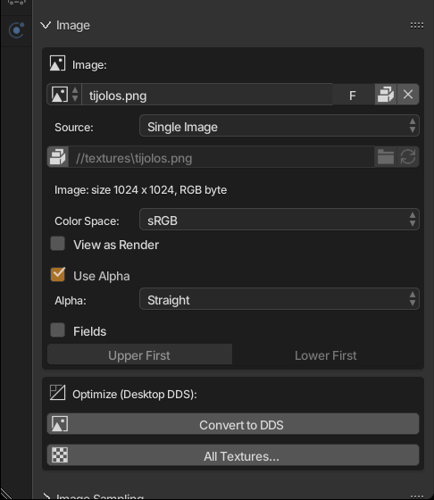
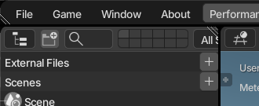
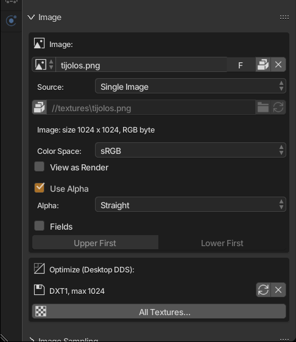

Las texturas PNG o JPG ocupan mucha memoria de video. El formato **DDS** queda comprimido en la GPU, usa hasta **8 veces menos memoria** y trae los mipmaps listos, así el juego carga más rápido. Ahora puedes convertir **una sola imagen**, directo en su panel.

:::note
El DDS se usa solo en el **juego exportado a PC** (Windows y Linux). El editor, la Web y Android siguen usando la imagen original.
:::

## Paso a paso

1. **Guarda el proyecto** (`Ctrl+S`): la copia DDS se graba junto a él.
2. Selecciona el objeto y abre **Propiedades > Texture**.
3. Elige la textura de imagen. Abajo del panel **Image** está la caja **Optimize (Desktop DDS)**:

4. Haz clic en **Convert to DDS** y elige:

| Opción | Qué hace |
|---|---|
| **Maximum size** | Lado mayor de la textura en el juego: **Original**, 4096, 2048, 1024 o 512. |
| **Quality** | **High** comprime con más cuidado (predeterminado). **Fast** convierte más rápido. |

5. Haz clic en **OK** y **guarda el proyecto** de nuevo.

Después, el botón de **recargar** convierte de nuevo, la **X** vuelve a la imagen original y **All Textures...** convierte todas las texturas del proyecto.

## Formato automático

| Imagen | Formato |
|---|---|
| Color sin transparencia | BC1 (DXT1) |
| Color con transparencia | BC3 (DXT5) |
| Normal map | BC5 |

Los archivos quedan en `textures_dds/`, junto al `.range`. Si editas la imagen original, la engine lo nota al exportar y pide convertir de nuevo.
