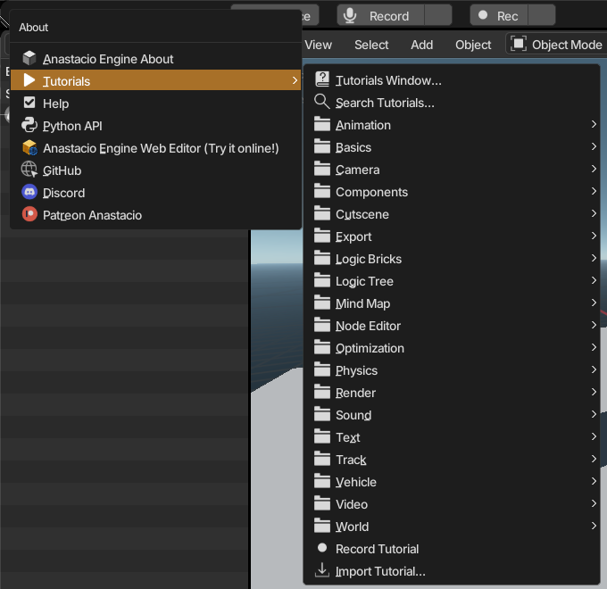
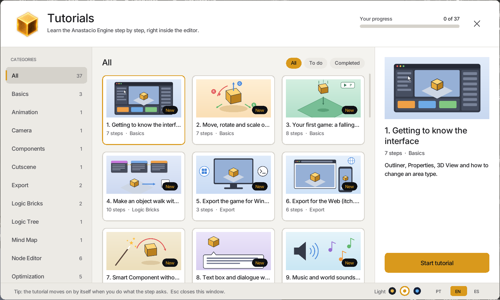
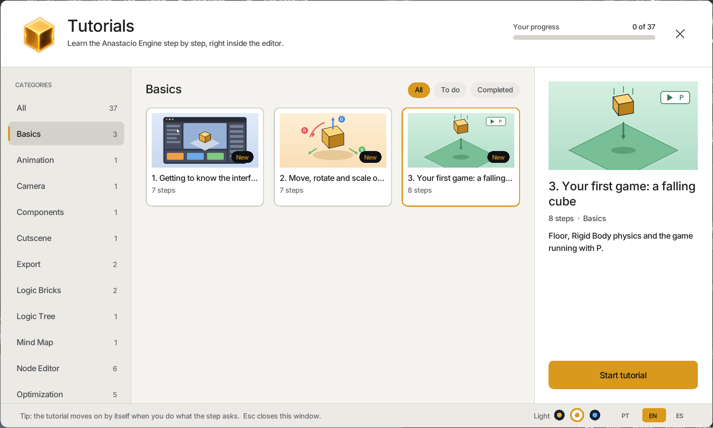
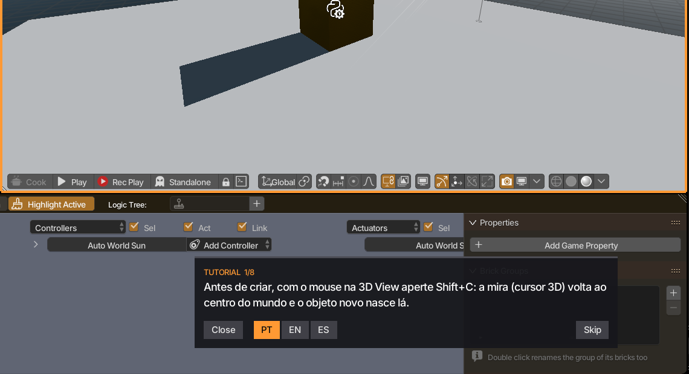
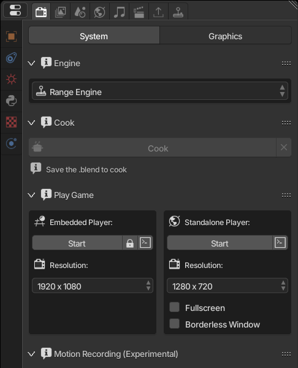

La engine trae **tutoriales interactivos** en portugués, inglés y español. Una tarjeta muestra qué hacer, y el tutorial **avanza solo** cuando haces el paso en el editor de verdad. Para dudas puntuales, **Help** pone una "i" en los paneles con la explicación de cada uno.

## Abrir los tutoriales

Todo está en el menú **About**, en la barra superior:

- **Tutorials > Tutorials Window...** abre la ventana con todos los tutoriales.
- **Tutorials > Search Tutorials...** busca por nombre.
- Las carpetas (**Basics**, **Animation**, **Camera**...) llevan directo a cada tutorial.
- **Help** activa o desactiva la "i" en los paneles.

## La ventana de tutoriales

A la izquierda están las **categorías**; arriba, los filtros **Todos**, **Pendientes** y **Completados** y **Tu progreso**; abajo, los temas y el idioma (**PT / EN / ES**). Haz clic en una tarjeta para ver los detalles y luego en **Empezar tutorial** (o **Continuar desde el paso N** si paraste a la mitad). **Esc** cierra la ventana.

## Haciendo un tutorial

La tarjeta muestra el número del paso y qué hacer, y destaca la parte de la pantalla involucrada. Haz lo que pide el paso y el siguiente aparece solo. **Skip** salta el paso y **Close** cierra el tutorial (el progreso queda guardado).

## Botón Help

Con **About > Help** activado, los paneles con explicación muestran una **"i"** junto al nombre:

Al hacer clic en la "i" se abre una ventanita con lo que hace el panel, el botón para **hacer el tutorial** de ese tema (cuando existe) y los botones de idioma. Help sigue activado las próximas veces que abras la engine.
