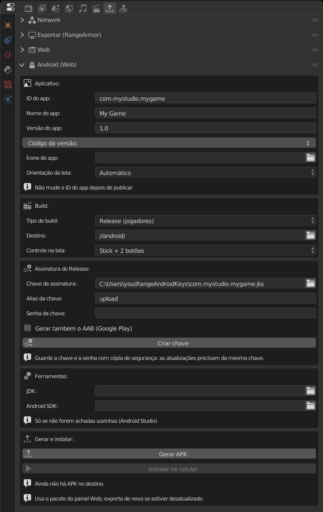

O export Android gera um **APK**: um app que roda a versão [Web](../web/) do jogo por dentro, offline, sem precisar de internet. Por isso, configure e valide o Web primeiro: os controles na tela e os avisos de lá valem aqui.

## 1. O que instalar antes

A engine **não** traz as ferramentas do Android. Instale uma vez:

1. **[Android Studio](https://developer.android.com/studio)**. Ele traz o **JDK** (Java) e o **Android SDK**, os dois que a engine precisa.
2. Abra o Android Studio uma vez e deixe ele terminar de baixar o SDK.
3. Em **Tools > SDK Manager > SDK Platforms**, instale **Android SDK Platform 37**.

A engine acha o Android Studio sozinha (também procura em `JAVA_HOME` e `ANDROID_HOME`). Se ele estiver num lugar diferente, aponte as pastas em **Tools > JDK** e **Android SDK** no painel.

:::caution[Versão 0.5.0]
No pacote da **0.5.0** o **Build APK** falha com *"Android template not found"*: o template do app ficou de fora do zip. No Linux, a 0.5.0 também veio sem o runtime Web. A correção sai na próxima versão da engine.
:::

## 2. Abrir o painel

**Propriedades > Export Game > Android (Web)**.



Com a interface em português, os nomes aparecem traduzidos, como no print. Neste guia eles estão em inglês, o idioma padrão da engine.

## 3. App

| Campo | O que faz |
|---|---|
| **App ID** | Identidade única do app, no formato `com.seunome.seujogo` (letras, números e `_`, separados por pontos; cada parte começa com letra). |
| **App name** | Nome que aparece embaixo do ícone. Vazio usa o nome do arquivo. |
| **App version** | Versão que o jogador vê, por exemplo `1.0`. |
| **Version code** | Número inteiro. **Aumente a cada versão nova** (1, 2, 3...), senão o celular recusa a atualização. |
| **App icon** | PNG quadrado, de preferência 512×512. Vazio usa o ícone padrão do Android. |
| **Screen orientation** | **Automatic** (gira com o celular), **Landscape** (deitado) ou **Portrait** (em pé). |

:::caution
**Nunca mude o App ID depois de publicar.** Para o Android seria outro app: o jogador teria dois ícones e perderia o save.
:::

## 4. Build

- **Build type**:
  - **Debug (testing)**: para testar no **seu** celular. Não precisa de chave. Use este enquanto desenvolve.
  - **Release (players)**: versão final, assinada com a sua chave. Use para distribuir.
- **Destination**: pasta onde saem o APK, o relatório e o log (padrão `//android/`).
- **Touch controls**: o mesmo controle na tela do painel Web.

## 5. A chave de assinatura (.jks)

Só é pedida no **Release**. Todo app Android precisa ser assinado, e **toda atualização precisa ser assinada com a mesma chave** do primeiro lançamento.

**Você não precisa conseguir esse arquivo em lugar nenhum: a engine cria para você.**

1. Mude **Build type** para **Release (players)**. A caixa **Release Signing** aparece.
2. Preencha:
   - **Key alias**: nome da chave dentro do arquivo. Pode deixar `upload`.
   - **Key password**: uma senha com **pelo menos 6 caracteres**.
3. Clique em **Create key**.

A engine usa o `keytool` do JDK para gerar a chave (RSA 4096, válida por uns 27 anos) e já preenche o campo **Signing key**. Se você deixou esse campo vazio, o arquivo vai para:

```
C:\Users\<você>\RangeAndroidKeys\<App ID>.jks
```

Para escolher outro lugar, preencha **Signing key** com o caminho do arquivo **antes** de clicar em **Create key**. A engine nunca sobrescreve uma chave que já existe.

:::danger[Faça backup da chave e da senha]
Copie o `.jks` para um pendrive ou nuvem e anote a senha num lugar seguro. **Se perder qualquer um dos dois, você não consegue mais atualizar o jogo**: teria que publicar como um app novo, e os jogadores perderiam o save. Não coloque a chave dentro do projeto nem no Git.
:::

Já tem uma chave `.jks` de outro jogo ou do Android Studio? Pode usar: aponte **Signing key** para ela e preencha o alias e a senha dela.

A senha não é salva no `.range`. Ao reabrir a engine, digite de novo antes de gerar.

## 6. Gerar o APK

Clique em **Build APK**. A engine salva o arquivo e roda o Gradle em segundo plano (a primeira vez demora mais porque ele baixa dependências). O progresso aparece no painel.

O resultado fica em **Destination**: o `.apk`, o `android-report.json` e o `gradle.log` (abra este se algo der errado).

**Also build AAB (Google Play)**: gera também o `.aab`, formato que a **Google Play exige**. O APK continua sendo gerado para você instalar no celular.

## 7. Instalar no celular

1. No celular, ative as **Opções do desenvolvedor** (em *Sobre o telefone*, toque 7 vezes em *Número da versão*) e, dentro delas, a **Depuração USB**.
2. Ligue o celular no PC pelo cabo USB e aceite o aviso *"Permitir depuração USB?"* na tela do celular.
3. Clique em **Install on phone**. O jogo instala e abre sozinho.

Também dá para copiar o `.apk` para o celular e abrir pelo gerenciador de arquivos (o Android pede para permitir "fontes desconhecidas").

## 8. Publicar na Google Play

1. Gere em **Release** com **Also build AAB** ligado.
2. No [Google Play Console](https://play.google.com/console), crie o app e envie o `.aab`.
3. Na primeira vez, aceite o **Play App Signing**: o Google guarda a chave final e a sua `.jks` vira a *chave de upload*. Mesmo assim, guarde o backup dela.
4. Para cada atualização: aumente o **Version code**, gere de novo com a **mesma chave** e envie o `.aab` novo.

## Problemas comuns

| Mensagem | Solução |
|---|---|
| *JDK and Android SDK not found* (ou *JDK not found*) | Instale o Android Studio ou aponte as pastas em **Tools**. |
| *The Android SDK ... does not have platform 37* | Android Studio > SDK Manager > instale **Android SDK Platform 37**. |
| *No phone connected* | Cabo USB ligado e **Depuração USB** ativa. Teste outro cabo: alguns só carregam. |
| *The phone did not authorize this computer* | Desbloqueie o celular e aceite o aviso de depuração USB. |
| *The phone already has ... signed with another key* | O celular tem uma versão com outra chave (por exemplo, a Debug). Desinstale e instale de novo. |
| *The phone has a newer version* | Aumente o **Version code**. |
| Erro de senha ou alias ao gerar | A senha ou o alias não batem com o `.jks`. |
| *Android template not found* | Falha da versão **0.5.0**: o pacote saiu sem o template Android. Corrigido na próxima versão da engine. |
