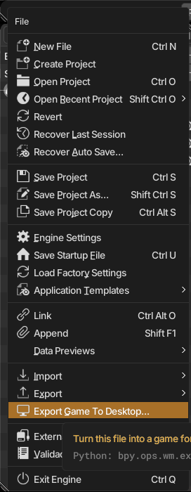
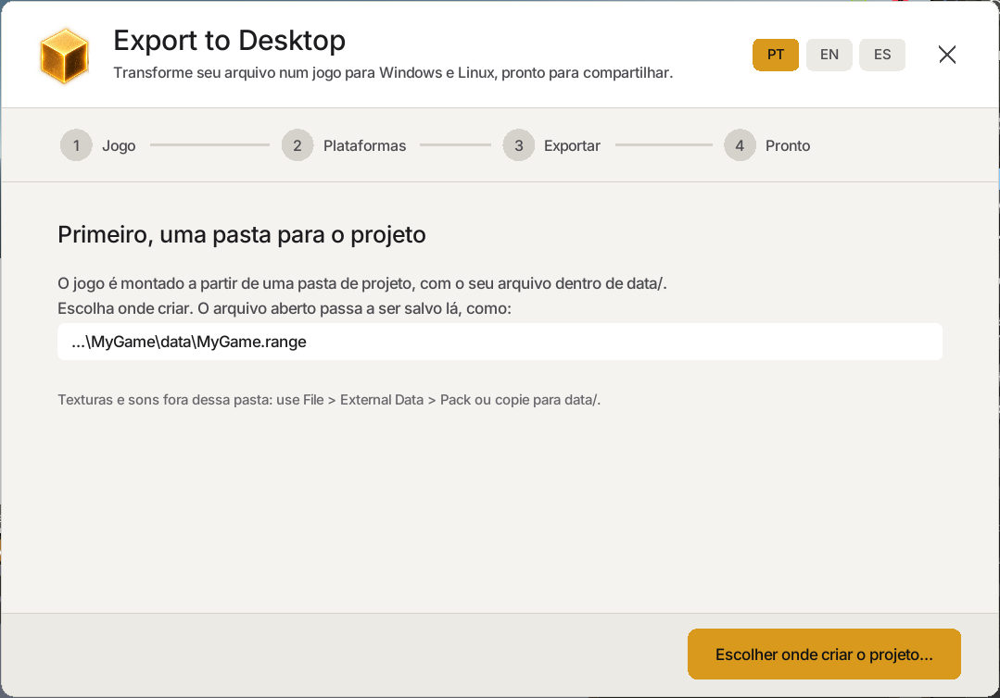
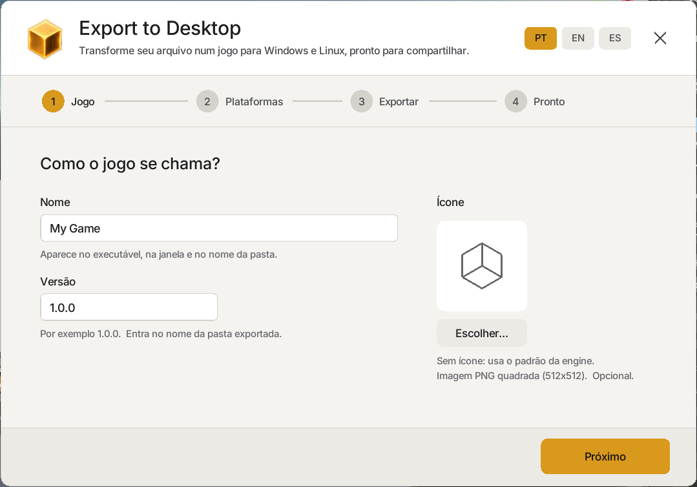
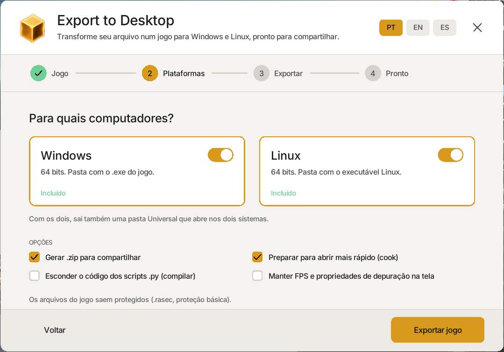
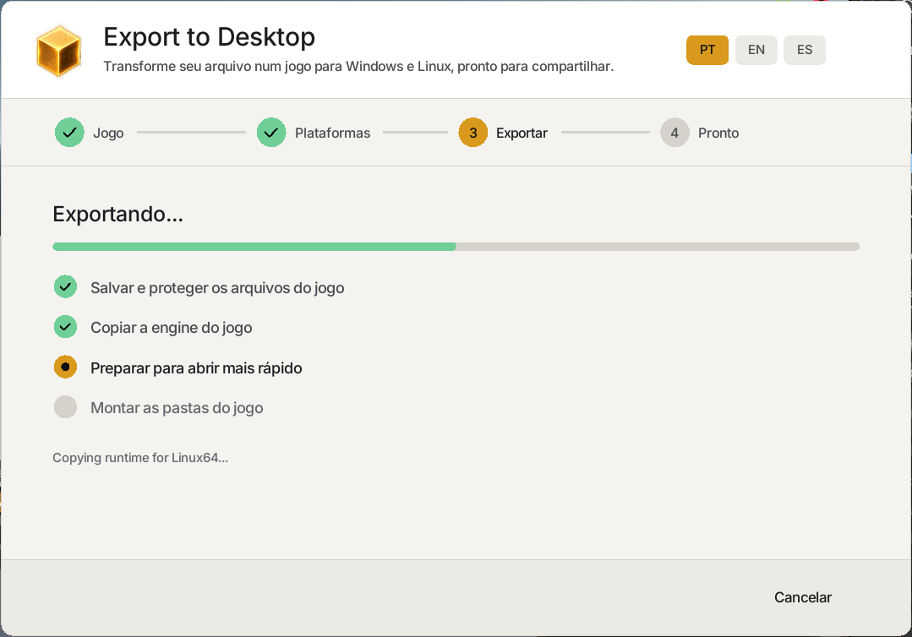
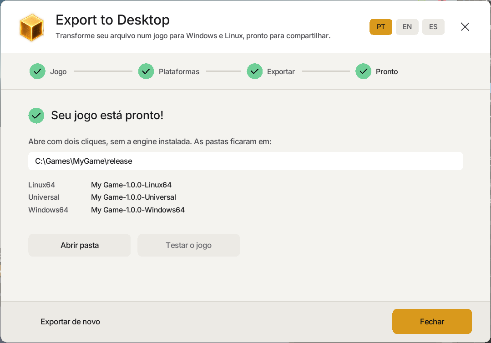

A janela **Export to Desktop** transforma o seu `.range` num jogo que abre com dois cliques, sem a engine instalada. Uma única exportação gera a versão **Windows 64-bit** e a **Linux 64-bit**, e com as duas ligadas sai também uma pasta **Universal** que abre nos dois sistemas.

:::note[Mudou desde a RangeArmor]
A exportação agora vem dentro da engine. Não é mais preciso baixar a RangeArmor, criar a pasta `rangearmor/` nem salvar o `.rasec` à mão: a janela faz tudo isso sozinha.
:::

## Abrir a janela

- **File > Export Game To Desktop...**, ou
- **Propriedades > Export Game > Export to Desktop**, botão **Export to Desktop...**

A janela tem os passos **Jogo → Plataformas → Exportar → Pronto**, mostrados no topo. Os botões **PT / EN / ES** trocam o idioma e **Esc** ou o **X** fecham.

## Antes: a pasta do projeto

O jogo é montado a partir de uma pasta de projeto, com o arquivo dentro de `data/`. Se o arquivo aberto ainda não está numa pasta assim, a janela começa por este passo:

Clique em **Escolher onde criar o projeto...** e escolha uma pasta. A engine cria `MeuJogo/data/` e salva o arquivo aberto lá dentro, como `MeuJogo/data/MeuJogo.range`. Daí em diante, edite esse arquivo.

:::caution
Texturas, sons e scripts que estão fora da pasta do projeto não vão junto. Use **File > External Data > Pack** ou copie-os para dentro de `data/`, com **caminhos relativos** (`//textures/...`).
:::

## 1. Jogo

| Campo | O que faz |
|---|---|
| **Nome** | Aparece no executável, na janela do jogo e no nome da pasta. Obrigatório. |
| **Versão** | Por exemplo `1.0.0`. Entra no nome da pasta exportada. |
| **Ícone** | Imagem PNG quadrada (512x512), opcional. Sem ícone, usa o da engine. |

## 2. Plataformas

Clique nos cartões **Windows** e **Linux** para ligar ou desligar cada um. Se um cartão aparece cinza com *"Engine desta plataforma não encontrada"*, falta o runtime daquele sistema na sua instalação.

Opções:

| Opção | O que faz |
|---|---|
| **Gerar .zip para compartilhar** | Além da pasta, gera um `.zip` pronto para enviar. |
| **Preparar para abrir mais rápido (cook)** | Gera o cache "cozido" (física e shaders prontos). Deixe ligado. |
| **Esconder o código dos scripts .py (compilar)** | Entrega os scripts compilados em vez do código-fonte. |
| **Manter FPS e propriedades de depuração na tela** | Mantém os textos de depuração no jogo exportado. Deixe desligado para o jogador. |

Os arquivos do jogo saem protegidos (`.rasec`, proteção básica). Clique em **Exportar jogo**.

## 3. Exportar

A janela mostra cada etapa: salvar e proteger os arquivos, copiar a engine do jogo, preparar para abrir mais rápido e montar as pastas. O editor continua respondendo e dá para **Cancelar**.

Se algo der errado, o título vira *"A exportação parou"* com a mensagem de erro. **Copiar log** copia o registro completo e **Exportar jogo** tenta de novo.

## 4. Pronto

As pastas ficam em `MeuJogo/release/`, uma por plataforma e a **Universal**. **Abrir pasta** mostra o resultado e **Testar o jogo** abre a versão deste computador.

## Exportar de novo

Depois da primeira vez, o botão **Export Now (last settings)**, em **Propriedades > Export Game > Export to Desktop**, exporta direto com as últimas escolhas, sem abrir a janela.

## Testar e distribuir

1. **Extraia o zip numa pasta qualquer fora do projeto** (ou copie a pasta exportada para outro lugar).
2. Abra o executável e jogue do começo ao fim.
3. Se funcionar, é esse zip que você envia ao jogador (itch.io, Steam, Google Drive...).

Testar fora do projeto é importante: dentro dele o jogo pode achar arquivos que não foram para o pacote.

## Proteção do arquivo

O jogo exportado usa uma cópia **protegida** do `.range` (`.rasec`), que não abre no editor. Guarde sempre o `.range` original: só ele pode ser editado.
