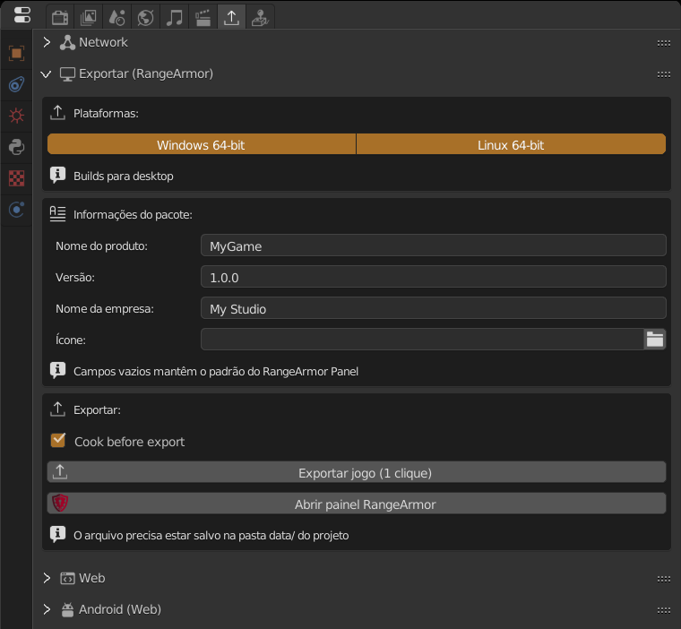

A **RangeArmor** é a ferramenta que empacota o jogo para PC. Ela junta o runtime da engine, o seu `.range` protegido e um launcher num executável que o jogador abre com dois cliques. Uma única exportação pode gerar a versão **Windows 64-bit** e a **Linux 64-bit**.

:::note
O painel da RangeArmor roda no Windows. Ele exporta para Windows e para Linux.
:::

## 1. Instalar a RangeArmor

A RangeArmor é baixada separada da engine, na mesma página da release (`RangeArmor-<versão>-windows-x64.zip`).

1. Extraia o zip.
2. Renomeie a pasta extraída para **`rangearmor`** e coloque-a **dentro da pasta da engine**, ao lado do `AnastacioEngine.exe`:

```
AnastacioEngine-0.5.0-windows-x64/
├── AnastacioEngine.exe
├── AnastacioRuntime.exe
└── rangearmor/
    ├── RangeArmor Panel.exe
    └── release/
```

A engine procura exatamente `rangearmor/RangeArmor Panel.exe` nesse lugar. Se a pasta tiver outro nome, os botões de export não acham a ferramenta.

## 2. Criar o projeto

A RangeArmor trabalha com uma pasta de projeto em formato fixo. O jeito mais fácil de criar é pela engine:


No menu **File** ficam **Create Project**, **Export Game With RANGEARMOR** e **Save .Range Protected File**.

1. **File > Create Project**.
2. Escolha onde criar e dê um nome (sem `< > : " / \ | ? *`).
3. A engine cria esta estrutura e já abre o `.range` novo:

```
MeuJogo/
├── data/            ← o .range do jogo fica AQUI
│   ├── MeuJogo.range
│   ├── scripts/  textures/  models/  audio/  fonts/  scenes/  libloads/
├── engine/          ← runtime copiado na exportação
├── launcher/        ← config.json e launcher
├── icons/
└── release/         ← resultado da exportação
```

:::caution[Regra mais importante]
O `.range` principal precisa estar **dentro da pasta `data/`** do projeto. Se ele estiver em outro lugar, o export avisa: *"Current file is not inside a RangeArmor project"*.
:::

Já tem um jogo pronto? Crie o projeto e depois copie o seu `.range` e os arquivos dele (texturas, sons, scripts) para dentro de `data/`, mantendo as mesmas subpastas para os caminhos relativos continuarem valendo.



Com a interface em português, os nomes aparecem traduzidos, como no print. Neste guia eles estão em inglês, o idioma padrão da engine.

## 3. Configurar no painel Export (RangeArmor)

Em **Propriedades > Export Game > Export (RangeArmor)**:

| Campo | O que faz |
|---|---|
| **Windows 64-bit / Linux 64-bit** | Plataformas geradas. Pode ligar as duas. |
| **Product Name** | Nome do jogo, usado no executável e no pacote. |
| **Version** | Versão do pacote, por exemplo `1.0.0`. |
| **Company Name** | Seu nome ou estúdio. |
| **Icon** | Arquivo `.ico` do executável. Vazio usa o ícone padrão. |
| **Cook before export** | Gera o cache "cozido" (física e shaders prontos) para o jogo abrir mais rápido. Deixe ligado. |

Campos vazios mantêm os valores padrão da RangeArmor.

## 4. Exportar

Há dois botões:

- **Export Game (1 Click)**: salva uma cópia protegida, cozinha o cache e gera tudo direto em `MeuJogo/release/`. Ao terminar, a pasta abre sozinha. **É o caminho recomendado.**
- **Open RangeArmor Panel**: abre a ferramenta completa, com mais opções. As configurações do painel da engine são passadas para ela.

O mesmo painel também abre por **File > Export Game With RANGEARMOR**.

:::tip
Se aparecer *"Could not find a Python interpreter for the export"*, abra o RangeArmor Panel uma vez, clique em **Get RanGE** e tente o 1 Click de novo.
:::

## Outra forma: usar o RangeArmor Panel sozinho

Você também pode exportar sem passar pelos botões da engine, abrindo a ferramenta externa direto. É útil para exportar um projeto antigo ou mexer em opções que o painel da engine não mostra.


Tela inicial do RangeArmor Panel: **Open Project**, **New Project** e a lista **Recent projects**.

1. Abra **`rangearmor/RangeArmor Panel.exe`**, na pasta da engine. Também abre pelo botão **Open RangeArmor Panel** ou por **File > Export Game With RANGEARMOR**.
2. Na tela inicial, clique em **New Project** para criar uma pasta de projeto nova ou em **Open Project** para abrir uma existente (por exemplo, a criada pelo **File > Create Project**). Os projetos abertos antes aparecem em **Recent projects**.
3. Na engine, abra o seu `.range` e salve a cópia protegida com **File > Save .Range Protected File** dentro da pasta `data/` do projeto. Ela tem a extensão `.rasec`.
4. De volta ao painel, na aba **Project**:

| Campo | O que faz |
|---|---|
| **Game Name** | Nome do jogo. |
| **Version** | Versão do jogo. |
| **Main File** | O arquivo `.rasec` do passo 3. Enquanto ele for o arquivo de exemplo, o export fica bloqueado. |
| **Data Source** | Pasta com os arquivos do jogo (normalmente `data`). |
| **Compile Python scripts** | Entrega os scripts compilados em vez do código-fonte. |

5. Na aba **Paths**, confira **Engine executables** (o runtime de cada plataforma) e **Python for authoring tools**. Se estiverem vazios, use na aba **Tasks** o botão **Copy Available Range Engine Files**, que copia o runtime da engine para a pasta `engine/` do projeto.
6. Clique em **Save** para gravar as configurações.
7. Na aba **Tasks**:
   - **Run game**: roda o jogo como o jogador vai ver, para testar antes.
   - **Set Icons**: escolhe os ícones `.ico` do launcher e do executável.
   - **Export to**: exporta uma plataforma ou **All Platforms**. **Compress targets after export** gera o zip.
8. O resultado vai para a pasta `release/` do projeto. **Explore** abre a pasta e **Copy Log** copia o log se algo der errado.

:::note
O botão **Export Game (1 Click)** da engine faz os passos 3 a 7 sozinho, e ainda cozinha o cache. Use o painel externo quando precisar de controle manual.
:::

## 5. Testar e distribuir

1. Abra `release/` e **extraia o zip gerado numa pasta qualquer fora do projeto**.
2. Abra o executável do jogo e jogue do começo ao fim.
3. Se funcionar, esse zip é o que você envia ao jogador (itch.io, Steam, Google Drive...).

Testar fora do projeto é importante: dentro dele o jogo pode achar arquivos que não foram para o pacote.

## Proteção do arquivo

O jogo exportado usa uma cópia **protegida** do `.range` (extensão `.rasec`), que não abre no editor. Você também pode gerar essa cópia à mão em **File > Save .Range Protected File**. Guarde sempre o `.range` original: só ele pode ser editado.

## Problemas comuns

| Mensagem | Solução |
|---|---|
| *Save the .blend file inside the project's data/ folder first* | Salve o arquivo dentro de `data/`. |
| *Current file is not inside a RangeArmor project* | O `.range` não está em `<projeto>/data/`. Use **File > Create Project**. |
| *build_release.py not found next to RangeArmor Panel* | A pasta `rangearmor/` está faltando ou com outro nome. Veja o passo 1. |
| *Export finished with errors* | Abra o console (**Window > Toggle System Console**) para ver o erro completo. |
