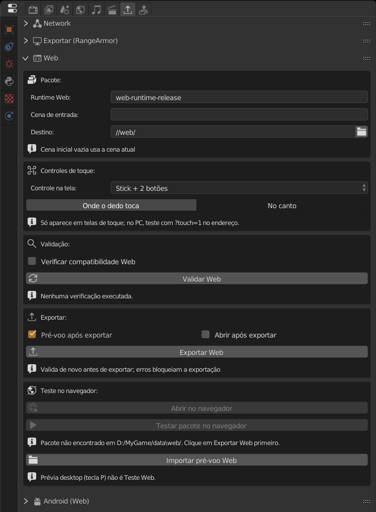

O export Web gera uma pasta que roda o jogo **dentro do navegador** (Chrome, Edge, Firefox e navegador do celular), com WebGL 2 e WebAssembly. O jogador abre um link, clica em **Jogar**, e pronto: não instala nada.

:::note
O runtime Web já vem no zip da engine, na pasta `web/` ao lado do `AnastacioEngine.exe`. Não precisa baixar mais nada.
:::

## 1. Abrir o painel

**Propriedades > Export Game > Web**. O painel vem fechado; clique no título para abrir.

Com a interface em português, os nomes aparecem traduzidos, como no print. Neste guia eles estão em inglês, o idioma padrão da engine.

## 2. Package (pacote)

| Campo | O que faz |
|---|---|
| **Web runtime** | Qual runtime usar. Deixe `web-runtime-release`. |
| **Entry scene** | Cena inicial do jogo. Vazio usa a cena atual. |
| **Destination** | Pasta de saída. O padrão `//web/` cria uma pasta `web` ao lado do `.range`. |

## 3. Touch Controls (controle na tela)

Em celular e tablet não há teclado. Aqui você escolhe o controle virtual que aparece **só em telas de toque**. Ele vale também para o Android.

| Layout | Para jogos que leem... |
|---|---|
| **Stick + 2 buttons** | Gamepad: stick esquerdo e botões A/B |
| **D-pad + 4 buttons** | Gamepad: direcional e A/B/X/Y |
| **Two sticks** | Gamepad: dois sticks |
| **Stick as WASD + Space** | Teclado: o stick aperta W/A/S/D e o botão aperta Espaço |
| **D-pad as arrows + Space/Enter** | Teclado: setas, Espaço e Enter |
| **First person (WASD + look)** | Teclado e mouse: anda com WASD e olha em volta com o stick direito |
| **Racing (steer + pedals)** | Gamepad: volante no stick, pedais nos gatilhos; o jogador pode trocar para setas ou inclinar o aparelho |
| **None** | Sem controle; o toque vira clique do mouse |

**Stick mode** escolhe se o stick aparece onde o dedo toca (**Where the finger touches**) ou fica fixo no canto (**In the corner**).

:::tip
Escolha o layout que combina com o que o jogo lê. Se o jogo usa sensor **Keyboard**, use *WASD* ou *arrows*; se usa **Joystick**, use os de gamepad. O **Validate Web** avisa (regra `WEB-INPUT-001`) quando o layout não aperta uma tecla que o jogo usa.
:::

Para ver o controle no PC, abra o jogo com `?touch=1` no fim do endereço e use o mouse como dedo.

## 4. Validar

Clique em **Validate Web**. A engine analisa cenas, logic bricks, scripts e arquivos e lista os problemas:

- **Erro** (ícone ✖): bloqueia o export. Precisa corrigir.
- **Aviso** (ícone ⚠): exporta, mas algo pode não funcionar no navegador.
- **Info**: só informação.

Muitos itens têm o botão **Locate**, que seleciona o objeto com problema. Depois de corrigir, valide de novo.

## 5. Exportar

1. Salve o arquivo (`Ctrl+S`).
2. Opções:
   - **Preflight after export**: depois de exportar, abre o pacote num Chrome/Edge invisível por uns 15 s e junta ao relatório os erros que o navegador viu. Deixe ligado.
   - **Open after export**: abre o jogo no navegador ao terminar.
3. Clique em **Export Web**.

O export valida de novo antes de gerar. Se falhar, o pacote anterior é mantido.

## 6. Testar no navegador

Não dá para abrir o `index.html` com dois cliques: o navegador bloqueia WebAssembly vindo de arquivo local. Use o servidor da engine:

- **Browser Test > Open in browser**: sobe um servidor local e abre o jogo. Clique em **Jogar** na página.
- **Stop server** desliga o servidor (ele também fecha junto com a engine).

:::caution
Apertar **P** no editor **não** é um teste Web. O navegador tem limites que o PC não tem; teste sempre pelo **Open in browser**.
:::

Dica: `?debug=1` no fim do endereço mostra o log do runtime na página.

## 7. Publicar

A pasta de destino é um site pronto (`index.html`, `RangeRuntime.*`, `game/`, `manifest.json`...). Junto vem um `HOSTING.md` com receitas para cada serviço.

- **itch.io**: compacte o *conteúdo* da pasta num zip (o `index.html` precisa estar na raiz do zip), crie um projeto do tipo **HTML** e marque *This file will be played in the browser*.
- **GitHub Pages, Netlify, servidor próprio**: suba a pasta inteira.

Requisitos do servidor:

- Servir `.wasm` como `application/wasm`.
- Ligar compressão gzip ou brotli: o download cai de ~46 MB para ~17 MB.
- Não precisa de cabeçalhos COOP/COEP.

Ao publicar uma versão nova, mude a versão do pacote para o navegador não usar a antiga do cache.

## Bom saber

- O **som** só começa depois que o jogador clica em **Jogar** (regra dos navegadores). Formatos: WAV, MP3 e OGG. Efeitos de som do OpenAL não existem no Web.
- O **save** (`saveGlobalDict`) fica guardado no navegador, por site. Trocar de domínio ou limpar os dados do site apaga o save.
- A página tem botão **Tela cheia**. No Android ela tenta travar em paisagem; no iPhone o botão não aparece (o Safari não deixa).
- Placa de vídeo mínima: **WebGL 2**.
