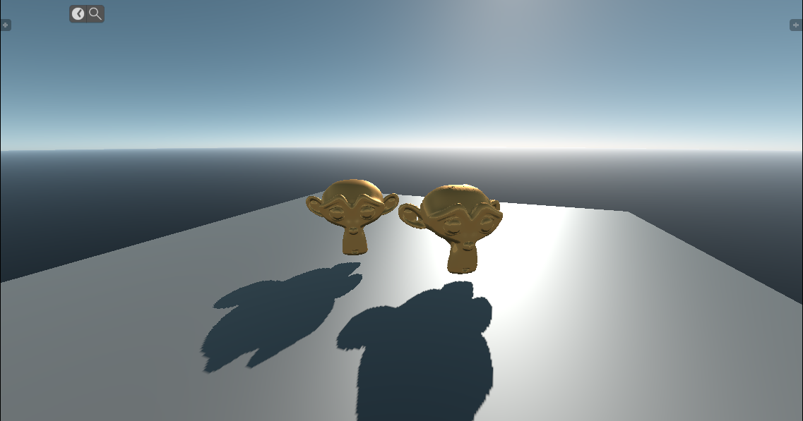
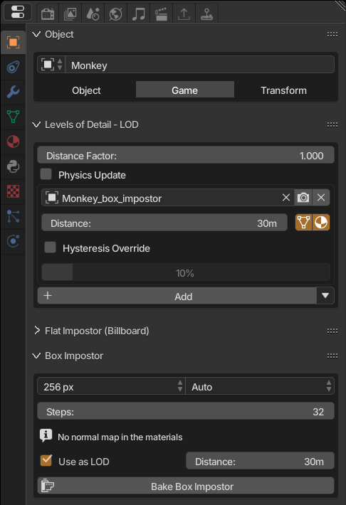
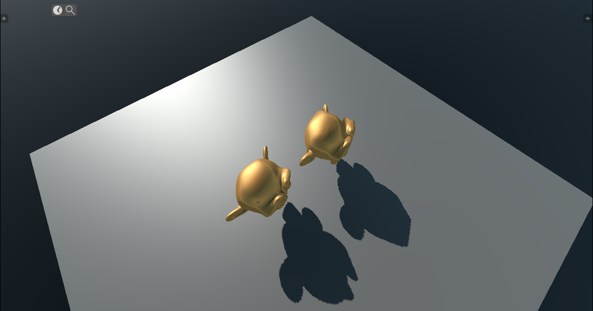

O **Box Impostor** fotografa o objeto de 6 lados e guarda essas vistas num card que sempre olha para a câmera. No jogo, o card desenha o objeto com **volume de verdade**: dá para olhar de lado, de cima ou rodar em volta, e a luz da cena continua batendo nele. É uma forma barata de encher a cena de objetos que ficam longe da câmera.

À esquerda, a malha original (7.872 faces). À direita, o card do impostor: um único quadrado.

## Quando usar

| Situação | Melhor escolha |
|---|---|
| Árvores e plantas vistas só de lado, bem longe | **Flat Impostor (Billboard)**: um plano que gira em Z, o mais barato. |
| Casas, caixas, rochas, carros parados, estátuas | **Box Impostor**: mantém o volume de qualquer ângulo, inclusive de cima. |
| Objeto perto da câmera | A malha normal (ou um nível de LOD com menos faces). |

O Box Impostor gasta um pouco mais de GPU que o Flat Impostor, mas bem menos que a malha cheia. Numa cena de teste com 1.600 macacos subdivididos, o tempo de desenho caiu de 1,73 ms para 0,27 ms com os cards.

## Passo a passo

1. Selecione o objeto (precisa ser uma malha).
2. Em **Propriedades > Object**, clique em **Game** na faixa do topo.
3. Abra o painel **Box Impostor** (fica embaixo de **Levels of Detail - LOD**).

4. Ajuste as opções e clique em **Bake Box Impostor**.

| Opção | O que faz |
|---|---|
| **Resolução** (64 a 512 px) | Tamanho de cada uma das 6 vistas. 256 é um bom padrão; use mais só para objetos grandes na tela. |
| **Modo** | **Auto** escolhe sozinho. **Box** faz uma leitura só e serve para objetos que enchem a caixa (casas, caixotes, paredes); é o mais rápido. **Volume** serve para qualquer forma (personagens, árvores, o macaco do exemplo). |
| **Steps** | Passos da busca no modo Volume. Menos passos deixam mais rápido, mas partes finas podem sumir. |
| **Include Normal Map** | Leva os normal maps do material para o impostor. Dobra o tempo do bake. Só aparece se o material tiver normal map. |
| **Use as LOD** + **Distance** | Coloca o card como nível de LOD do objeto: a partir dessa distância da câmera, o jogo troca a malha pelo card. |

Depois do bake, o painel **Levels of Detail - LOD** mostra o card `<objeto>_box_impostor` como novo nível, na distância escolhida. O card fica na **camada 20**, fora da vista, e as imagens assadas são `<objeto>_imp_color` e `<objeto>_imp_data`.

## Testar

Aperte **P** e afaste a câmera. Passando da distância do LOD, a malha vira o card, e a troca quase não aparece. Para comparar de perto, como nos prints, copie o card (`Shift+D`), mova a cópia para a camada 1 e ponha ao lado do original.

Visto de cima, o impostor continua com a forma do objeto, coisa que um billboard comum não consegue.

## Dicas

- **Mudou o objeto ou o material?** Clique em **Bake Box Impostor** de novo. O card e as imagens são refeitos no lugar.
- **Muitas cópias:** o card funciona com GPU Instancing, então centenas de cópias custam pouco.
- **Objetos presos a ossos** (um chapéu na cabeça do personagem, por exemplo) também funcionam.
- **Sombra:** a sombra do card é uma aproximação. Se ela chamar atenção, aumente a distância do LOD.
- Por Python, o nível máximo de LOD de um objeto pode ser limitado com [`KX_GameObject.lodLevelMax`](../../api/types/kx_gameobject/#lodlevelmax).
