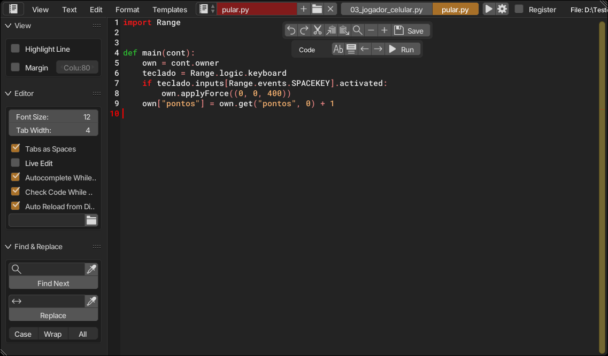
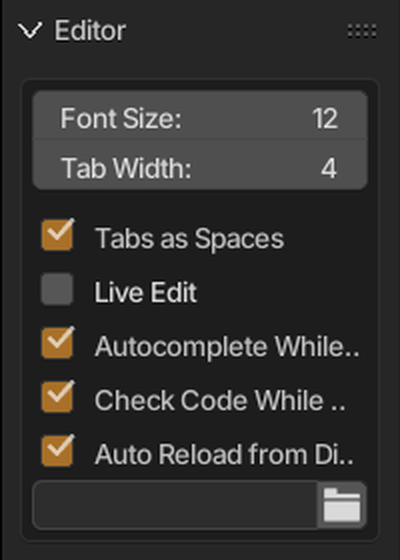

Dá para escrever os scripts do jogo no **VS Code** (ou em outro editor) e ver as mudanças chegarem à engine sem fazer nada: o **Text Editor** abre o arquivo no editor externo com um clique, e recarrega o script sozinho quando você salva lá.



## Antes: o script precisa ser um arquivo

O editor externo só abre scripts que estão salvos em disco. Se o texto foi criado dentro da engine (**Text > New**), salve-o primeiro com **Text > Save As**, de preferência numa pasta `scripts/` ao lado do `.range`. Scripts abertos com **Text > Open** já estão ligados ao arquivo.

## Abrir no editor externo

Na barra do Text Editor, ao lado do botão de rodar o script (▶), clique no botão **Open in External Editor** (a engrenagem):


- O arquivo abre no **VS Code, já na linha onde está o cursor**.
- Se você mexeu no texto dentro da engine, ela salva antes de abrir, para o VS Code ver a versão atual.
- O texto ainda não foi salvo em arquivo? A engine avisa e abre o **Save As**.

O botão de script dos **Smart Components** (no Component Manager) usa o mesmo editor.

## Recarregar sozinho

Salve no VS Code (`Ctrl+S`) e volte para a engine: o texto já está atualizado, com o cursor no mesmo lugar. A engine confere os arquivos a cada meio segundo.

A opção fica na barra lateral do Text Editor (`Ctrl+T`), painel **Editor**:



- **Auto Reload from Disk** liga ou desliga o recarregamento. Vem ligado.
- O campo logo abaixo é o **caminho do editor externo** (o botão da pasta abre o seletor).

:::caution[Mexeu nos dois lugares?]
Se o texto foi editado **na engine** e **no disco** ao mesmo tempo, ela não recarrega sozinha, para não apagar o que você escreveu. Aparece a barra **Resolve Conflict**: escolha qual versão fica.
:::

## Escolher outro editor

Com o campo vazio, a engine procura o VS Code (`code`, `code-insiders` ou `codium` no PATH, ou a instalação padrão no Windows). Se não achar, usa o programa padrão do sistema para `.py`.

Para usar outro editor, ponha o caminho dele no campo. Se o editor precisar de argumentos, use `{file}` e `{line}`:

```
C:\Program Files\Notepad++\notepad++.exe -n{line} {file}
```

O caminho vale para todos os arquivos `.range`, porque fica guardado na pasta de configuração do usuário.

## Por Python

O recarregamento usa `Text.reload()`, que também pode ser chamado nos seus scripts do editor:

```python
import bpy
bpy.data.texts["pular.py"].reload()  # lê o arquivo de novo, mantendo o cursor
```
