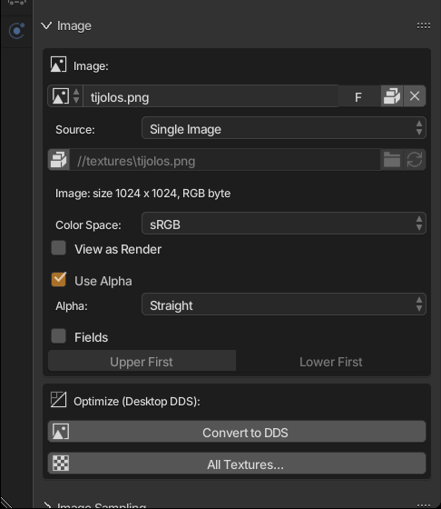
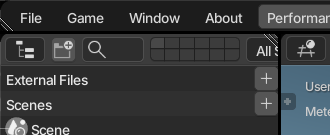
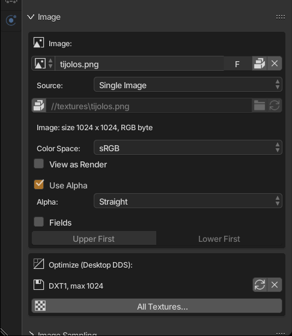

Texturas em PNG ou JPG ocupam muito espaço na placa de vídeo. O formato **DDS** fica comprimido na própria GPU, ocupa até **8 vezes menos memória** e já leva os mipmaps prontos, o que deixa o jogo carregar mais rápido. Agora dá para converter **uma imagem só**, direto no painel dela.

:::note
O DDS é usado só no **jogo exportado para PC** (Windows e Linux). No editor, na Web e no Android continua valendo a imagem original, que você pode seguir editando.
:::

## Passo a passo

1. **Salve o projeto** (`Ctrl+S`). A cópia em DDS é gravada ao lado dele, então o botão só funciona depois de salvar.
2. Selecione o objeto e abra **Propriedades > Texture**.
3. Escolha a textura de imagem na lista. No painel **Image**, embaixo, fica a caixa **Optimize (Desktop DDS)**:

4. Clique em **Convert to DDS**. Aparecem duas opções:

| Opção | O que faz |
|---|---|
| **Maximum size** | Maior lado da textura no jogo: **Original**, 4096, 2048, 1024 ou 512. Diminuir economiza ainda mais memória. |
| **Quality** | **High** comprime com mais cuidado (padrão). **Fast** é mais rápido de converter. |

5. Clique em **OK** e **salve o projeto** de novo, para guardar a escolha.

Pronto: a caixa passa a mostrar o formato e o tamanho usados.

## Botões depois de converter

- **Recarregar** (setas) converte de novo, por exemplo depois de mudar o tamanho máximo ou a imagem.
- **X** desfaz: o jogo volta a usar a imagem original.
- **All Textures...** abre a conversão de todas as texturas do projeto de uma vez.

## O formato é escolhido sozinho

| Imagem | Formato |
|---|---|
| Cor sem transparência | BC1 (aparece como DXT1) |
| Cor com transparência | BC3 (DXT5) |
| Normal map | BC5 |

Os arquivos ficam na pasta `textures_dds/`, ao lado do `.range`. Se você editar a imagem original depois, a engine percebe na hora de exportar e pede para converter de novo.

## Quando converter

- Texturas grandes (1024 ou mais) e muitas texturas na mesma cena.
- Jogo travando ao carregar ou usando muita memória de vídeo (veja o menu **Performance**).

Não precisa converter ícones pequenos do HUD nem imagens que só aparecem no editor.
