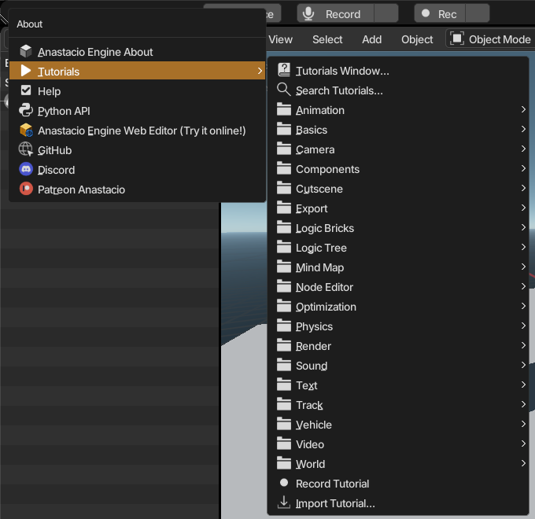
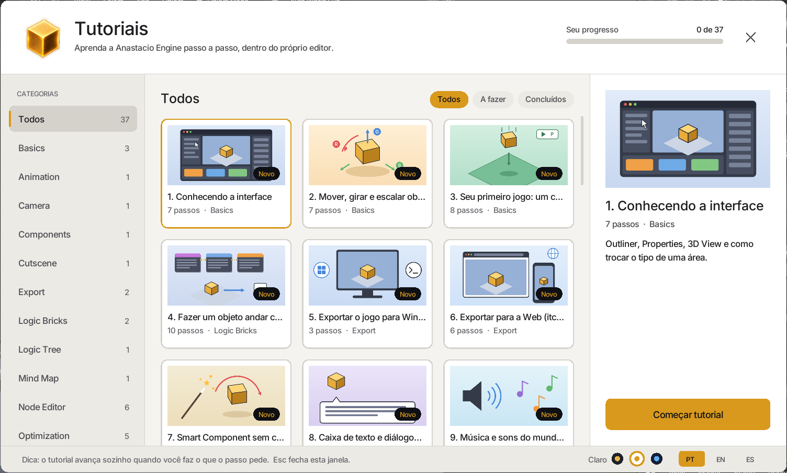
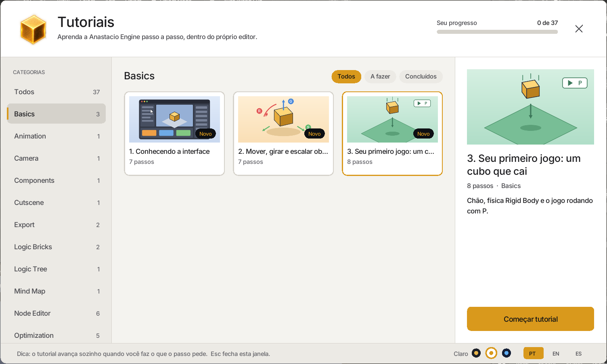
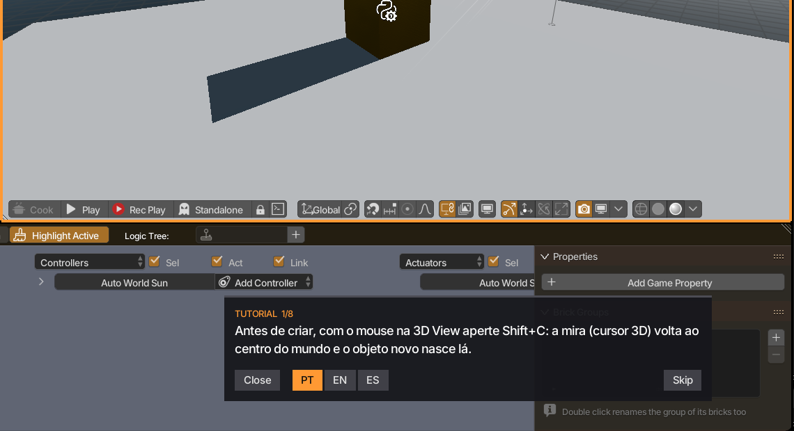
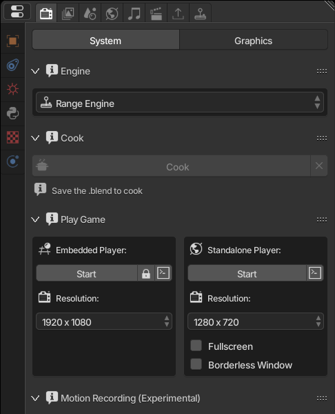

A engine traz **tutoriais interativos** em português, inglês e espanhol. Um cartão mostra o que fazer, e o tutorial **avança sozinho** quando você faz o passo no editor de verdade. Para dúvidas pontuais, o **Help** coloca um "i" nos painéis com a explicação de cada um.

## Abrir os tutoriais

Tudo fica no menu **About**, na barra de cima:

- **Tutorials > Tutorials Window...** abre a janela com todos os tutoriais.
- **Tutorials > Search Tutorials...** procura pelo nome.
- As pastas (**Basics**, **Animation**, **Camera**...) dão acesso direto a cada tutorial.
- **Help** liga ou desliga o "i" nos painéis.

## A janela de tutoriais

- À esquerda ficam as **categorias**, com quantos tutoriais cada uma tem.
- Os filtros **Todos**, **A fazer** e **Concluídos** separam o que você já terminou.
- **Seu progresso** mostra quantos tutoriais você já fez.
- No rodapé ficam os temas (**Claro**, **Escuro**, **Azul**) e o idioma (**PT / EN / ES**).

Clique num cartão para ver os detalhes à direita:

**Começar tutorial** começa do zero. Se você parou no meio, aparece **Continuar do passo N**, e em tutoriais concluídos aparece **Refazer tutorial**. **Esc** fecha a janela.

:::note
Muitos tutoriais abrem uma cena inicial pronta. Se o arquivo aberto tiver mudanças sem salvar, a engine pergunta antes de trocar.
:::

## Fazendo um tutorial

O cartão fica sobre o editor e mostra o número do passo (**1/8**) e o que fazer. A parte da tela envolvida no passo fica destacada (no print, a 3D View, com borda laranja).

- Faça o que o passo pede: ele é marcado sozinho e o próximo aparece.
- **Skip** pula o passo, e **Close** encerra o tutorial (o progresso fica salvo).
- **PT / EN / ES** troca o idioma ali mesmo.

Ao terminar, o tutorial ganha um check verde no menu e conta no seu progresso.

## Botão Help

Com **About > Help** ligado, os painéis que têm explicação ganham um **"i"** ao lado do nome:

Clique no "i" para abrir uma janelinha com:

- o que o painel faz, em poucas linhas;
- quando existe, o botão para **fazer o tutorial** daquele assunto;
- os botões **PT / EN / ES**.

A janelinha some quando o mouse sai dela. O Help continua ligado nas próximas vezes que você abrir a engine, até ser desligado no mesmo menu.

## Lista de assuntos

São 37 tutoriais, do básico (interface, primeiro jogo, mover objetos) ao avançado: Logic Bricks, Logic Tree, Cutscene, Compositing, Light Probe Volume, SSGI, microfone, Character, Nodes GLSL, export para PC e para a Web, entre outros. A lista completa fica na janela de tutoriais.
