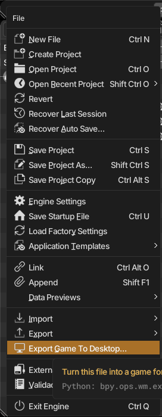
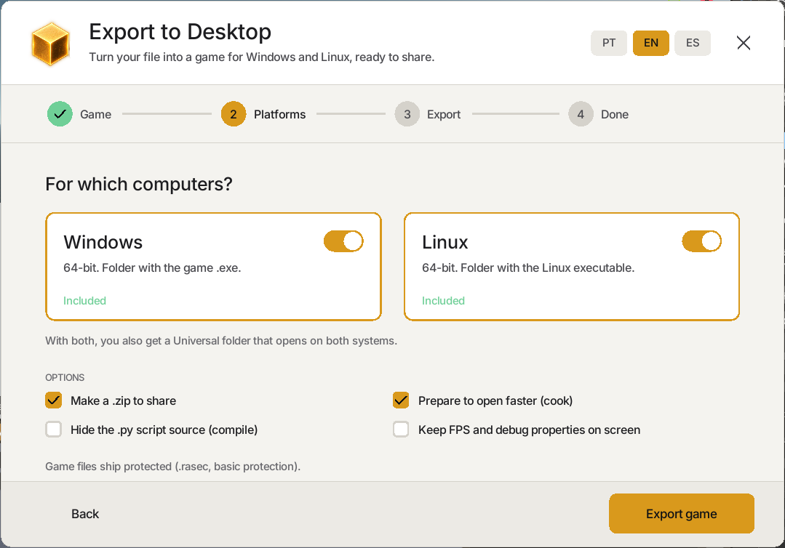
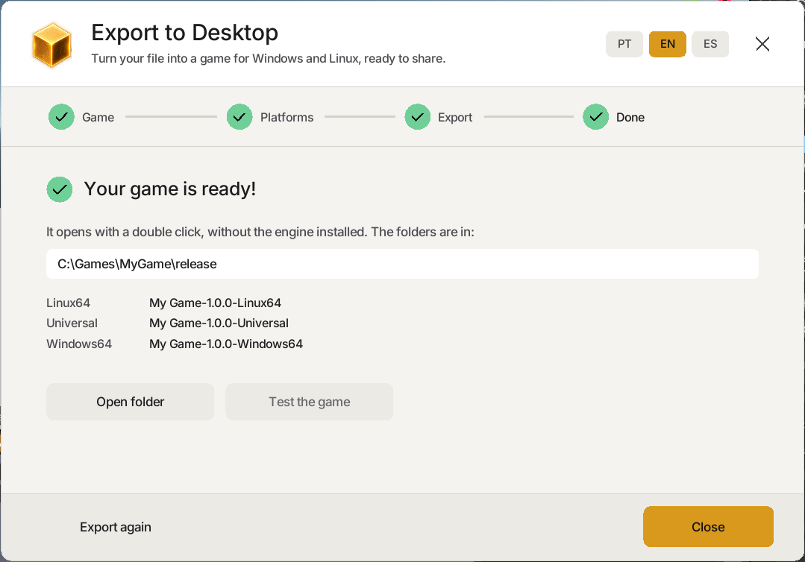

Окно **Export to Desktop** превращает ваш `.range` в игру, которая запускается двойным щелчком без установленного движка. Один экспорт собирает версии **Windows 64-bit** и **Linux 64-bit**, а если включены обе, появляется ещё папка **Universal**, работающая в обеих системах.

:::note[Изменилось после RangeArmor]
Экспорт теперь встроен в движок. Больше не нужно скачивать RangeArmor, создавать папку `rangearmor/` и вручную сохранять `.rasec`: окно делает всё само.
:::

## Как открыть окно

- **File > Export Game To Desktop...** или
- **Properties > Export Game > Export to Desktop**, кнопка **Export to Desktop...**

Шаги окна: **Game → Platforms → Export → Done**. Кнопки **PT / EN / ES** меняют язык; **Esc** или **X** закрывают окно.

## Сначала: папка проекта

Игра собирается из папки проекта, где ваш файл лежит в `data/`. Если открытый файл ещё не в такой папке, окно начнёт с этого шага: нажмите **Choose where to create the project...**, и движок создаст `MyGame/data/` и сохранит туда файл.

:::caution
Текстуры, звуки и скрипты вне папки проекта не попадут в игру. Используйте **File > External Data > Pack** или скопируйте их в `data/` с **относительными путями** (`//textures/...`).
:::

## 1. Game

| Поле | Назначение |
|---|---|
| **Name** | Имя в исполняемом файле, окне игры и названии папки. Обязательно. |
| **Version** | Например `1.0.0`. Входит в название папки. |
| **Icon** | Квадратный PNG 512x512, необязательно. |

## 2. Platforms

Щёлкайте по карточкам **Windows** и **Linux**, чтобы включить или выключить их.

| Опция | Назначение |
|---|---|
| **Make a .zip to share** | Кроме папки, создаёт `.zip` для отправки. |
| **Prepare to open faster (cook)** | Готовый кэш физики и шейдеров. Оставьте включённым. |
| **Hide the .py script source (compile)** | Скрипты поставляются скомпилированными. |
| **Keep FPS and debug properties on screen** | Для игроков выключите. |

Нажмите **Export game**.

## 3. Export и 4. Done

Окно показывает этапы и позволяет нажать **Cancel**. При ошибке **Copy log** копирует журнал. Результат лежит в `MyGame/release/` (по папке на платформу плюс **Universal**); на последнем экране есть **Open folder** и **Test the game**.

Потом кнопка **Export Now (last settings)** в **Properties > Export Game > Export to Desktop** экспортирует повторно с последними настройками, без окна.

## Проверка и распространение

1. Распакуйте zip в папку **вне проекта**.
2. Запустите игру и пройдите её целиком.
3. Если всё работает, отправляйте этот zip игрокам.

Игра использует **защищённую** копию `.range` (`.rasec`), которая не открывается в редакторе. Всегда храните исходный `.range`.
