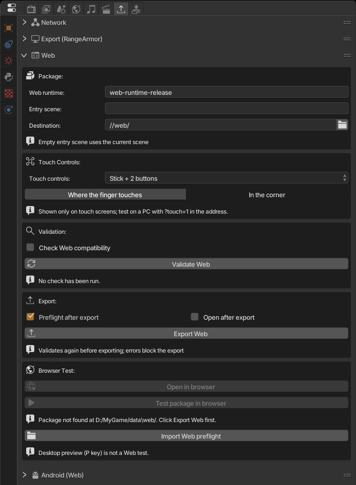

Экспорт в Web создаёт папку, которая запускает игру **прямо в браузере** (Chrome, Edge, Firefox и мобильные браузеры) с помощью WebGL 2 и WebAssembly. Игрок открывает ссылку, нажимает **Play** — и всё: ничего устанавливать не нужно.

:::note
Web-рантайм уже входит в zip движка, в папке `web/` рядом с `AnastacioEngine.exe` (или `AnastacioEngine` в Linux). Больше ничего скачивать не нужно.
:::

## 1. Откройте панель

**Properties > Export Game > Web**. Панель изначально свёрнута; нажмите на её заголовок, чтобы открыть.

## 2. Пакет

| Поле | Что делает |
|---|---|
| **Web runtime** | Какой рантайм использовать. Оставьте `web-runtime-release`. |
| **Entry scene** | Первая сцена игры. Если пусто — используется текущая сцена. |
| **Destination** | Папка вывода. По умолчанию `//web/` создаёт папку `web` рядом с `.range`. |

## 3. Touch Controls

У телефонов и планшетов нет клавиатуры. Здесь выбирается виртуальный контроллер, который показывается **только на сенсорных экранах**. Это относится и к Android.

| Раскладка | Для игр, которые читают... |
|---|---|
| **Stick + 2 buttons** | Геймпад: левый стик и кнопки A/B |
| **D-pad + 4 buttons** | Геймпад: крестовина и A/B/X/Y |
| **Two sticks** | Геймпад: два стика |
| **Stick as WASD + Space** | Клавиатура: стик нажимает W/A/S/D, кнопка — Space |
| **D-pad as arrows + Space/Enter** | Клавиатура: стрелки, Space и Enter |
| **First person (WASD + look)** | Клавиатура и мышь: движение на WASD, обзор правым стиком |
| **Racing (steer + pedals)** | Геймпад: руль на стике, педали на курках; игрок может переключиться на стрелки или наклон устройства |
| **None** | Без управления; касания превращаются в щелчки мыши |

**Stick mode** определяет, появляется ли стик там, где коснулся палец (**Where the finger touches**), или закреплён в углу (**In the corner**).

:::tip
Выбирайте раскладку под то, что читает ваша игра. Если игра использует сенсор **Keyboard**, берите *WASD* или *стрелки*; если **Joystick** — раскладку геймпада. **Validate Web** предупредит (правило `WEB-INPUT-001`), если раскладка не нажимает клавишу, которую использует игра.
:::

Чтобы увидеть управление на ПК, откройте игру с `?touch=1` в конце адреса и используйте мышь вместо пальца.

## 4. Проверка

Нажмите **Validate Web**. Движок проверяет сцены, logic bricks, скрипты и файлы и выводит список проблем:

- **Error** (значок ✖): блокирует экспорт. Нужно исправить.
- **Warning** (значок ⚠): экспорт пройдёт, но что-то может не работать в браузере.
- **Info**: только информация.

У многих пунктов есть кнопка **Locate**, которая выделяет проблемный объект. После исправления проверьте снова.

## 5. Экспорт

1. Сохраните файл (`Ctrl+S`).
2. Параметры:
   - **Preflight after export**: после экспорта открывает пакет в скрытом Chrome/Edge примерно на 15 с и добавляет в отчёт ошибки, которые увидел браузер. Оставьте включённым.
   - **Open after export**: по завершении открывает игру в браузере.
3. Нажмите **Export Web**.

Перед сборкой экспорт снова выполняет проверку. При неудаче предыдущий пакет сохраняется.

## 6. Проверка в браузере

Просто дважды щёлкнуть по `index.html` нельзя: браузеры блокируют WebAssembly, загружаемый из локальных файлов. Используйте сервер движка:

- **Browser Test > Open in browser**: запускает локальный сервер и открывает игру. Нажмите **Play** на странице.
- **Stop server** останавливает сервер (он также закрывается вместе с движком).

:::caution
Нажатие **P** в редакторе — **не** проверка Web. У браузера есть ограничения, которых нет на ПК; всегда проверяйте через **Open in browser**.
:::

Совет: `?debug=1` в конце адреса показывает лог рантайма на странице.

## 7. Публикация

Папка назначения — готовый сайт (`index.html`, `RangeRuntime.*`, `game/`, `manifest.json`...). В неё входит `HOSTING.md` с рецептами для каждого сервиса.

- **itch.io**: заархивируйте *содержимое* папки (`index.html` должен быть в корне zip), создайте проект типа **HTML** и отметьте *This file will be played in the browser*.
- **GitHub Pages, Netlify, собственный сервер**: загрузите всю папку.

Требования к серверу:

- Отдавать `.wasm` как `application/wasm`.
- Включить сжатие gzip или brotli: загрузка сокращается с ~46 МБ до ~17 МБ.
- Заголовки COOP/COEP не нужны.

При публикации новой версии меняйте версию пакета, чтобы браузеры не использовали старую из кэша.

## Полезно знать

- **Звук** запускается только после того, как игрок нажмёт **Play** (правило браузеров). Форматы: WAV, MP3 и OGG. Звуковых эффектов OpenAL в Web нет.
- **Сохранения** (`saveGlobalDict`) хранятся в браузере, отдельно для каждого сайта. Смена домена или очистка данных сайта стирает сохранение.
- На странице есть кнопка **Fullscreen**. В Android она пытается зафиксировать альбомную ориентацию; на iPhone кнопка скрыта (Safari этого не позволяет).
- Минимальная графика: **WebGL 2**.
