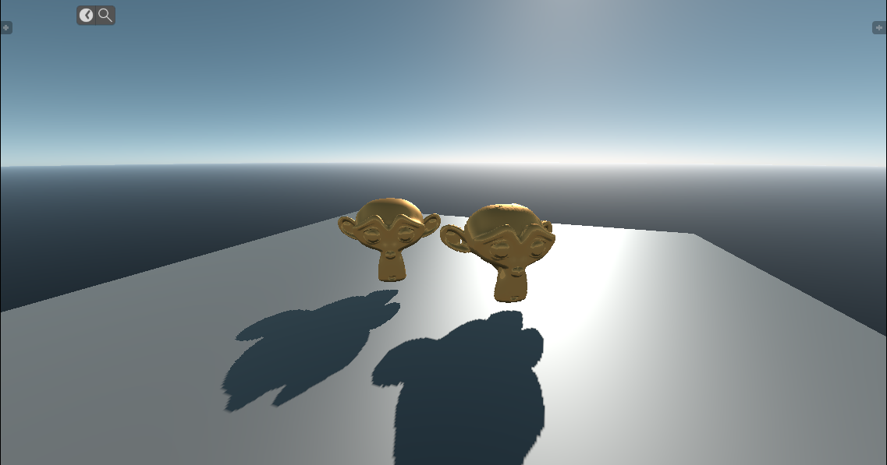
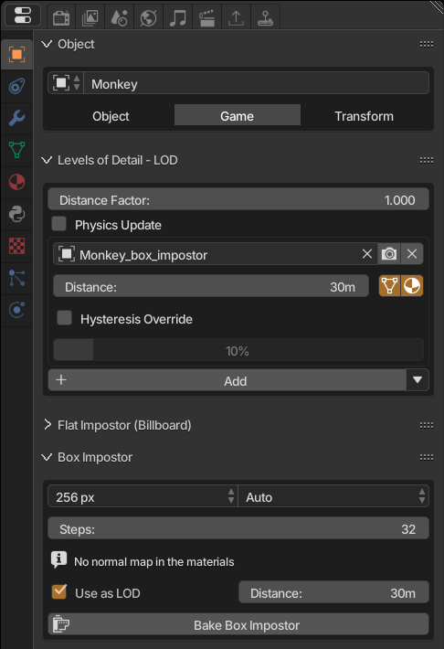
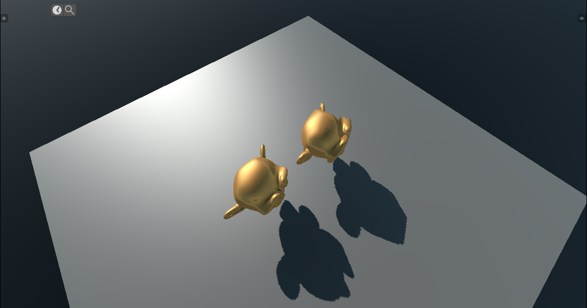

**Box Impostor** снимает объект с 6 сторон и хранит эти виды на карточке, которая всегда повёрнута к камере. В игре карточка рисует объект с **настоящим объёмом**: на него можно смотреть сбоку, сверху или обойти вокруг, а свет сцены продолжает его освещать.

Слева исходная сетка (7 872 грани). Справа карточка импостора: один квадрат.

## Когда использовать

| Ситуация | Лучший выбор |
|---|---|
| Деревья и растения, видимые только сбоку и издалека | **Flat Impostor (Billboard)**, самый дешёвый. |
| Дома, ящики, камни, стоящие машины, статуи | **Box Impostor**: сохраняет объём с любого ракурса. |
| Объект рядом с камерой | Обычная сетка (или уровень LOD с меньшим числом граней). |

В тестовой сцене с 1 600 подразделёнными обезьянами время отрисовки упало с 1,73 мс до 0,27 мс.

## Шаг за шагом

1. Выделите объект (это должна быть сетка).
2. В **Properties > Object** нажмите **Game**.
3. Откройте панель **Box Impostor** (под **Levels of Detail - LOD**).

4. Настройте параметры и нажмите **Bake Box Impostor**.

| Параметр | Назначение |
|---|---|
| **Разрешение** (64–512 px) | Размер каждого из 6 видов. 256 — хорошее значение. |
| **Mode** | **Auto** выбирает сам. **Box** — для объектов, заполняющих свой габарит (дома, ящики, стены), самый быстрый. **Volume** — для любой формы. |
| **Steps** | Шаги поиска в режиме Volume. Меньше — быстрее, но тонкие части могут пропасть. |
| **Include Normal Map** | Переносит normal map материала в импостор. Удваивает время запекания. |
| **Use as LOD** + **Distance** | Добавляет карточку как уровень LOD: дальше этого расстояния игра заменяет сетку карточкой. |

После запекания панель **Levels of Detail - LOD** покажет карточку `<объект>_box_impostor` как новый уровень. Карточка лежит на **слое 20**, вне вида.

## Проверка

Нажмите **P** и отведите камеру: после дистанции LOD сетка сменится карточкой.

## Советы

- Изменили объект или материал? Нажмите **Bake Box Impostor** ещё раз.
- Карточка работает с GPU Instancing, поэтому сотни копий стоят дёшево.
- Работает и на объектах, привязанных к костям.
- Тень карточки приблизительная; если это заметно, увеличьте дистанцию LOD.
- Из Python максимальный уровень LOD ограничивает [`KX_GameObject.lodLevelMax`](../../api/types/kx_gameobject/#lodlevelmax).
