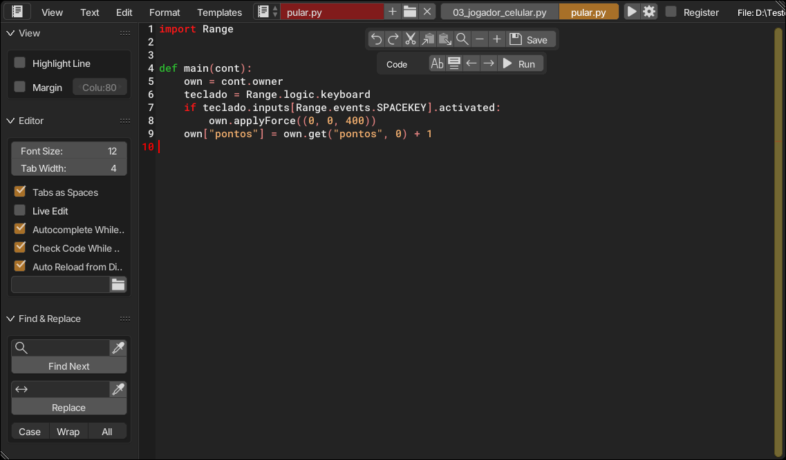
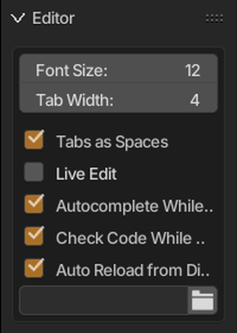

Скрипты игры можно писать в **VS Code** (или другом редакторе), и изменения сами попадут в движок: **Text Editor** открывает файл во внешнем редакторе одним щелчком и перечитывает скрипт, когда вы сохраняете его там.



## Сначала: скрипт должен быть файлом

Внешний редактор открывает только скрипты, сохранённые на диске. Если текст создан в движке (**Text > New**), сначала сохраните его через **Text > Save As**, лучше в папку `scripts/` рядом с `.range`.

## Открыть во внешнем редакторе

На панели Text Editor, рядом с кнопкой запуска (▶), нажмите **Open in External Editor** (шестерёнка):


- Файл откроется в **VS Code на строке курсора**.
- Если текст менялся в движке, он сначала сохраняется.
- Текст ещё не сохранён в файл? Движок предупредит и откроет **Save As**.

Кнопка скрипта у **Smart Components** использует тот же редактор.

## Автоматическая перезагрузка

Сохраните в VS Code (`Ctrl+S`) и вернитесь в движок: текст уже обновлён, курсор на месте. Настройка находится в боковой панели Text Editor (`Ctrl+T`), панель **Editor**:



- **Auto Reload from Disk** включает или выключает перезагрузку (по умолчанию включено).
- Поле ниже — **путь к внешнему редактору**.

:::caution[Правили в двух местах?]
Если текст изменён **в движке** и **на диске** одновременно, он не перезагружается сам. Появится панель **Resolve Conflict**, где нужно выбрать версию.
:::

## Другой редактор

Если поле пустое, движок ищет VS Code, а если не находит — открывает программу по умолчанию для `.py`. Для другого редактора укажите его путь; аргументы задаются через `{file}` и `{line}`:

```
C:\Program Files\Notepad++\notepad++.exe -n{line} {file}
```

## Из Python

Перезагрузка использует `Text.reload()`:

```python
import bpy
bpy.data.texts["pular.py"].reload()  # заново читает файл, сохраняя курсор
```
