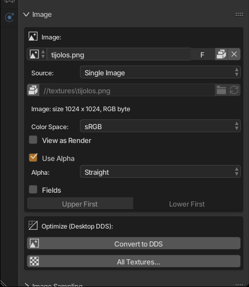
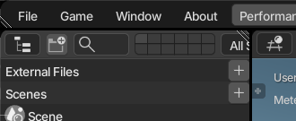
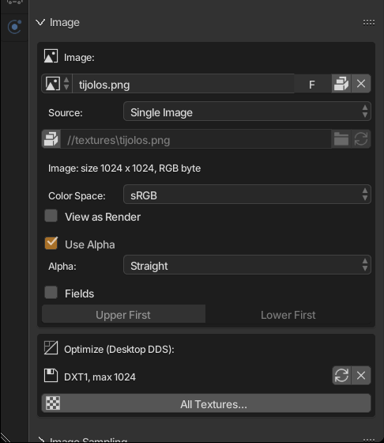

Текстуры PNG и JPG занимают много видеопамяти. Формат **DDS** остаётся сжатым прямо на GPU, занимает до **8 раз меньше памяти** и содержит готовые mipmap-уровни, поэтому игра загружается быстрее. Теперь можно конвертировать **одно изображение** прямо в его панели.

:::note
DDS используется только в **игре, экспортированной на ПК** (Windows и Linux). В редакторе, в Web и на Android остаётся исходное изображение.
:::

## Шаг за шагом

1. **Сохраните проект** (`Ctrl+S`): копия DDS записывается рядом с ним.
2. Выделите объект и откройте **Properties > Texture**.
3. Выберите текстуру-изображение. Внизу панели **Image** находится блок **Optimize (Desktop DDS)**:

4. Нажмите **Convert to DDS** и выберите:

| Параметр | Назначение |
|---|---|
| **Maximum size** | Наибольшая сторона текстуры в игре: **Original**, 4096, 2048, 1024 или 512. |
| **Quality** | **High** сжимает аккуратнее (по умолчанию). **Fast** конвертирует быстрее. |

5. Нажмите **OK** и снова **сохраните проект**.

Потом кнопка **обновления** конвертирует заново, **X** возвращает исходное изображение, а **All Textures...** конвертирует все текстуры проекта.

## Формат выбирается автоматически

| Изображение | Формат |
|---|---|
| Цвет без прозрачности | BC1 (DXT1) |
| Цвет с прозрачностью | BC3 (DXT5) |
| Normal map | BC5 |

Файлы лежат в папке `textures_dds/` рядом с `.range`. Если позже изменить исходное изображение, движок заметит это при экспорте и попросит сконвертировать заново.
