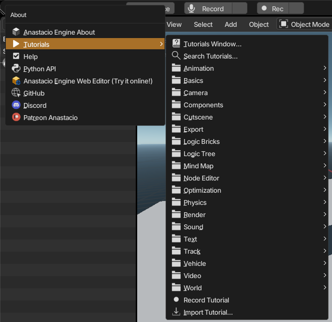
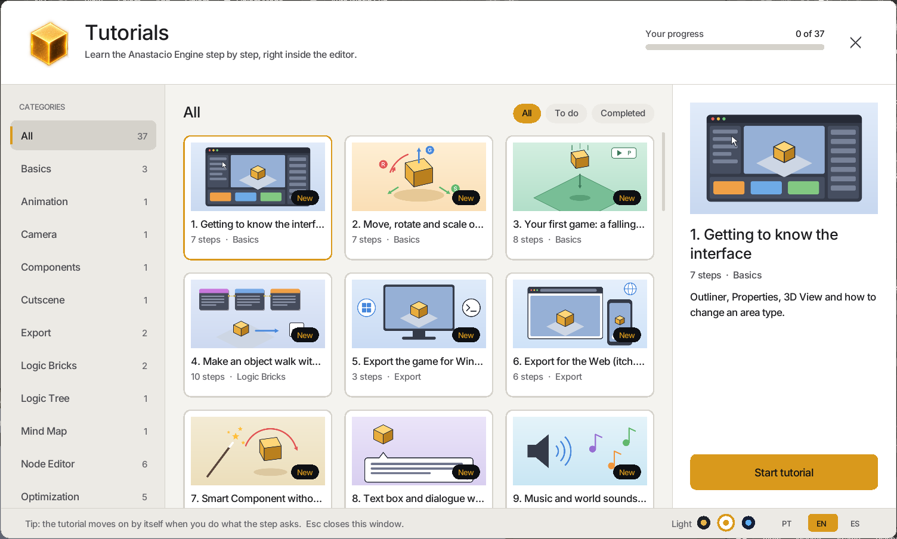
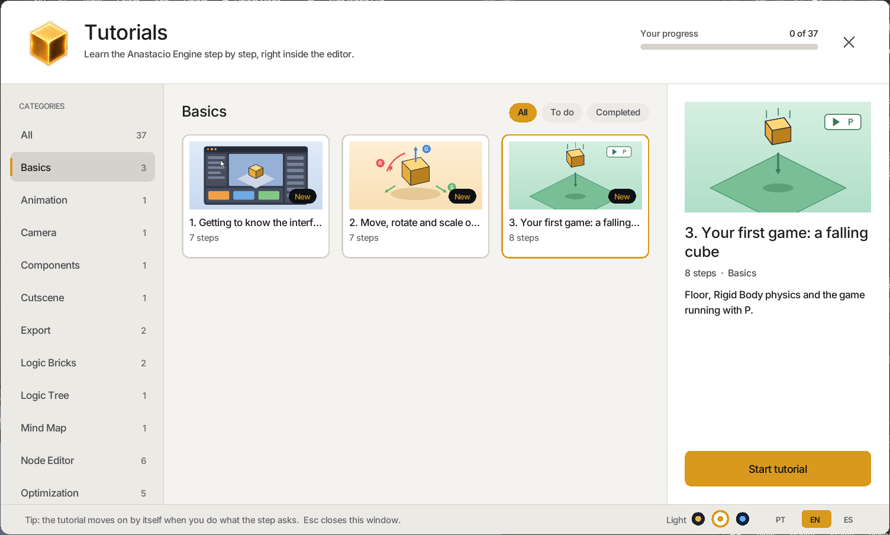
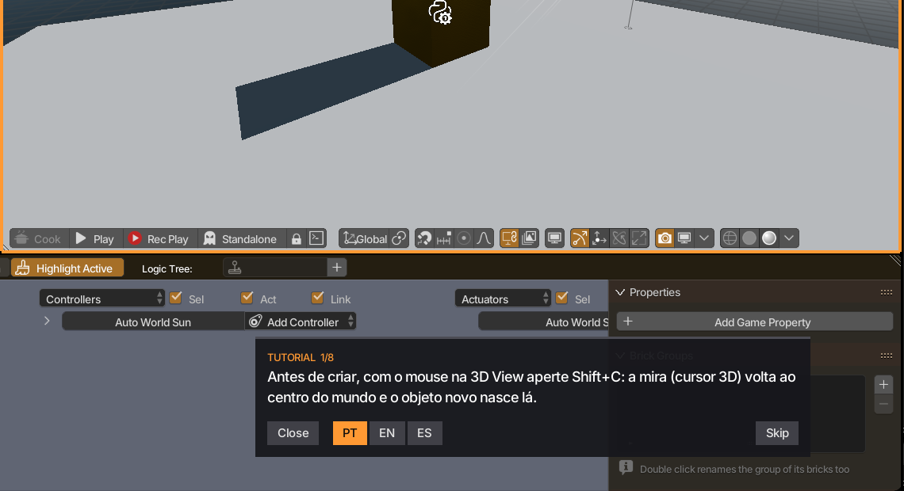
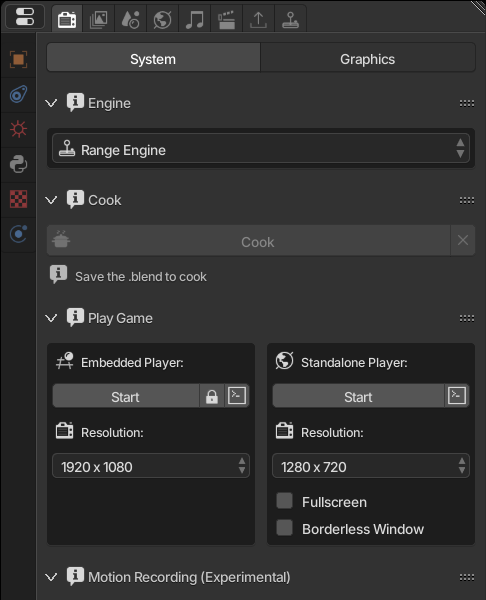

В движке есть **интерактивные уроки** на португальском, английском и испанском. Карточка показывает, что сделать, и урок **сам переходит дальше**, когда вы выполняете шаг в настоящем редакторе. Для быстрых вопросов **Help** добавляет значок «i» на панели с пояснением.

## Как открыть уроки

Всё находится в меню **About** на верхней панели:

- **Tutorials > Tutorials Window...** открывает окно со всеми уроками.
- **Tutorials > Search Tutorials...** ищет урок по названию.
- Папки (**Basics**, **Animation**, **Camera**...) ведут прямо к урокам.
- **Help** включает или выключает «i» на панелях.

## Окно уроков

Слева **категории**; сверху фильтры **All**, **To do**, **Completed** и **Your progress**; внизу темы и язык (**PT / EN / ES**). Щёлкните карточку, чтобы увидеть подробности, затем **Start tutorial** (или **Continue from step N**, если вы остановились на середине). **Esc** закрывает окно.

## Прохождение урока

Карточка показывает номер шага и что сделать, а нужная часть экрана подсвечивается. Выполните шаг, и следующий появится сам. **Skip** пропускает шаг, **Close** закрывает урок (прогресс сохраняется).

## Кнопка Help

Когда **About > Help** включён, у панелей с пояснением рядом с названием появляется **«i»**:

Щелчок по «i» открывает окошко с описанием панели, кнопкой **пройти урок** по этой теме (если он есть) и кнопками языка. Help остаётся включённым при следующих запусках движка.
